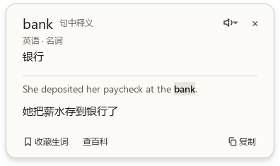

# WaxTranslate

在 Mac 上读外文时，把鼠标停在生词上，按 **⌥⇧T**，就能看到它在这句话里的意思。比如同一个 `bank`，在河边看水的句子里显示「岸边」，在存工资的句子里显示「银行」。浮窗里可以对照原句和整句译文，也可以把这个词连同语境存下来复习。

WaxTranslate 的 macOS 版使用 Vision 在本机识字，使用 Apple 翻译处理句子，支持 macOS 15.2 及以上。应用显示名为「我靠翻译」，当前开发版的磁盘文件名为 `waxtranlate.app`。Windows 开发版使用系统 OCR、离线识字包和本地翻译模型，支持快捷键取词和框选翻译。

## 产品目标

进度和验收记录见[双端开发路线图](https://github.com/wax0629/WaxTranslate/issues/3)。

| 目标 | 怎么验收 |
| --- | --- |
| Windows 和 macOS 双端 | 两台机器用同一段样文走完悬停取词、框选翻译和关闭浮窗。两端均有可运行的开发版。 |
| 操作清晰简洁 | 指向一个词，按一次快捷键，直接看到一条释义。框选用于翻译整段。缺少权限或语言包时给出一个明确的下一步。 |
| 字体与排版 | 词头、释义、例句有清楚的阅读顺序。用中英混排、长句和系统缩放检查字重、行距、换行与截断。 |
| 翻译准确 | 分别检查取到的词、拼出的原句和句中词义。用多义词、专业术语、否定句和跨行文本做回归；词典参考单独标注。 |

## WaxTranslate Windows 桌面版


在 Windows 11 x64 上完整解压便携包，双击 `WaxTranslate.exe`。程序默认在系统托盘待命，可以直接取词。点击时钟旁的 WaxTranslate 图标（可能在「显示隐藏的图标」里），或再次双击启动器，即可打开主窗口。便携包自带英语、日语和韩语的识字与简体中文翻译模型。要用法语、德语、西班牙语、意大利语、葡萄牙语或俄语，打开「设置 → 语言包」，选中语种并点「下载语言包」。显示「已安装」后即可离线使用，无需重启。下载的资源保存在当前用户目录，升级会复用其中已有的模型。

**鼠标指向单词，轻按一下左 Ctrl。** 在网页、PDF 等窗口即可查看句中词义。按住取词键并用左键拖选可翻译一段，也可在首页点「框选翻译」。点「打开对照翻译」可粘贴文章。首页的一行用法跟随当前取词键，点击这行文字可以更改设置。

首次查词后，首页自动显示累计和今日次数、收藏和待复习数量，以及最近查过的六个词和简短释义。同词同语种再次查询会置顶，累计次数加一。框选和整段翻译不计入词数。升级时会接续旧版本保留的计数。

顶栏左侧可以切换「首页」「对照翻译」和「生词本」，右侧齿轮进入「设置」。浅底标签标出当前页。拖动左侧字标或空白处可以移动窗口，双击可最大化或还原，边缘可拖动调整大小。右上角保留最小化、最大化和关闭按钮。普通窗口的内容铺到四边，Windows 11 下保留小圆角。

**设置**可以从主窗口导航或托盘右键菜单打开。开启「开机启动」后，下次登录当前 Windows 账户时，WaxTranslate 会进入托盘，取词键即可使用。该选项默认关闭。托盘可用时，主窗口不占任务栏按钮，最小化即收回托盘，查词仍可使用。关闭窗口也默认收起到托盘，可以在设置中改为直接退出；托盘菜单也提供「退出」。系统没有托盘时，程序用普通任务栏窗口打开。如果以前注册过启动项，后来把便携包移到新目录，可以在新版本的设置里点「改用当前版本」。

在**「对照翻译」页**可粘贴文章或点「试读示例」。示例里有河边和存钱两个场景，点各自的 `bank` 就能看到不同的释义。往空白原文框粘贴文章也会打开「单击查词」，拖动仍可选字。需要定位光标编辑原文时，取消勾选即可。双击查词和 **Alt+Enter** 也可用。应用内直接读取原文，不需要系统 OCR。

**读技术文章或论文**时，点 `ChatGPT`、`Codex`、`PRD`、`C++` 或 `Ciallo` 可以直接看中文解释。同一个 `MVP` 在产品和球赛报道里有不同含义，缺少线索时卡片列出常见义项。附近原文写出了缩写全称，或作者用 *the term … to mean …* 之类的表述明确解释了自己的用词时，优先显示「文中定义」，保留作者原话。屏幕取词能用到同栏可见原文；粘贴的文章还可以从相邻段落找定义。低频专业词可查随包附带的 76 万余条英汉词典参考。释义来自哪一路，会标在卡片上。

本机没有收录的英文词默认会在同一张卡片里自动补查 Wikidata，只发送所选词条。`Codex` 等已有本地解释的词直接出结果。可在「设置 → 未收录词自动查百科」关闭，升级会保留已保存的选择。关闭后仍可手动点「查百科」。返回多个完全同名的条目时显示至多三个，并附可打开的来源；没有命中时可继续搜索网页。OCR、原文和整句翻译始终在本机处理。

点取词卡或生词本里的「听读」听单词，右侧箭头可以选慢速或听原句。播放时再点一次即可停止。朗读使用 Windows 已安装的对应语种声音，离开卡片或切换词条时会停止。缺少对应声音时按卡片提示在 Windows 语音设置中添加。

取词卡把「英语 · 名词」这类信息放在词头下方。语言在本机根据原句识别，英文词性结合上下文和鼠标所指的那一次出现判断。英语直接译为简体中文，其余八种语言在本机经英语转译。两次翻译均能对齐所指词时，卡片标为「句中释义」，其余显示「单词参考」和整句译文。英文词性和英汉词典用于英语查词。对于尚未支持的语种，卡片提供「复制原文」。

默认自动识别原文语言。单独查法语的 `pain`（面包）这类多语种同形词时，可在「设置 → 原文语言」指定法语，然后重新查词。该选择同时用于阅读、悬停和框选。屏幕识字优先采用可用的 Windows OCR；指定语种缺少系统识别器或识别失败时，使用该语言包的本地 OCR。自动模式也会尝试日文假名、韩文和西里尔字母识别。音乐列表可指向歌名中的词查义，或单独框住整行翻译。仅含汉字的日文短标题可手动选日语。「对照翻译」直接使用粘贴的原文。

日文文章可直接点没有空格的词，例如在 `図書館で本を読む。` 中点「書」会选中「図書館」。韩文取词区分名词和紧随的助词，例如在 `도서관에서` 中点「관」会选中「도서관」（图书馆）。日语和韩语分词均在本机完成。

取词浮窗先显示词头、语种、词性和释义，再显示原句与句译。框选翻译时先看译文，需要对照时点「查看原文」。按住顶部或正文旁的留白可以拖开浮窗，拖选正文可以复制文字。



在「对照翻译」页粘贴原文后按 **Ctrl+Enter**，可直接对照原文与译文。按 **Ctrl+Shift+C** 复制当前译文。修改原文会清空旧译文，避免复制到上一段的结果。窗口较窄时，对照区自动改为上下排列。

取词时先用整句判断词义。对于较长的句子，浮窗会尝试保留命中词所在的分句；本地模型在分句中也能对齐到相同释义时，默认显示这段语境和对应译文。点「查看全句」可展开。复制的是当前显示的译文，点击「收藏生词」保存完整原句、句译和释义。同一词在不同语境里可以分别收藏。在「生词本」按 **Ctrl+F** 可按单词、释义或原句查找。点「开始复习」，先看原句，回想后点「查看释义」。选择「再学一次」会在十分钟后再次出现，「记住了」的间隔按 1、3、7、14、30、60 天递增。查词计数和最近六个词的词头、语种与短释义写入本机 `%LOCALAPPDATA%\WaxTranslate\notebook.sqlite3`。完整原句、句译及复习进度随手动收藏保存。退出旧版后，将新版解压到另一目录即可继续使用原生词本。

### 从源码运行

已在 Windows 11 25H2 x64 上验证。准备好含 `py` 启动器的 Python 3.12 x64。在项目根目录依次运行：

```powershell
.\windows\setup.cmd
.\windows\start.cmd
```

首次安装会创建项目专用的 `.venv`，下载并校验三个默认翻译模型、对应识字模型、1.5 MiB 的英文词性模型和 63 MiB 的 ECDICT 词典源文件。程序将词典转成只读索引，和模型一起存放在 `%LOCALAPPDATA%\WaxTranslate\models`。之后可离线启动。安装脚本可重复运行。翻译采用 Argos 发布的模型，日语和韩语分词分别使用 Janome 和 MeCab-ko 随包词典，英文词性标注采用 NLTK 发布的英语平均感知机模型。便携包随附默认模型、词典索引及其许可。离线识字使用 Tesseract 的 [tessdata_fast 模型](https://github.com/tesseract-ocr/tessdata_fast/tree/87416418657359cb625c412a48b6e1d6d41c29bd)。[ECDICT 词典来源](https://github.com/skywind3000/ECDICT/tree/39cfb9672c0906b63569e0453c2e6abfb9ab182a)

| 操作 | Windows 快捷键或入口 |
| --- | --- |
| 查一个词 | 鼠标指向原文中的词，**轻按并松开取词键**，默认为左 Ctrl。贴近词的边缘也可命中。浮窗显示释义、原句和可用的句译。 |
| 翻译选区 | **按住取词键，用鼠标左键拖动**。保持 Ctrl 按下，松开鼠标即可翻译，按 **Esc** 取消。也可点主窗口的「框选翻译」。 |
| 关闭或退出 | 点击浮窗外、按 **Esc** 或点「关闭」可收起浮窗。关闭主窗口默认收起到托盘；设置中可改为退出程序。 |

指向 `read/write` 中的 `write` 可以单独查右侧词。系统 OCR 将两侧合成一个词框时，程序按字宽估算分界，指向字母中部更准确。Ctrl+C 等组合键和 Ctrl+单击仍交给前台应用。如果同时开着 Hover 等取词软件，在「设置」的「屏幕取词键」切到右 Ctrl 或「仅应用内查词」。按键、窗口关闭和联网偏好保存到 `%LOCALAPPDATA%\WaxTranslate\preferences.ini`，登录启动由当前用户的 Windows 启动项管理。截图和语音只在内存中处理。

在 Windows x64 开发环境构建便携包：

```powershell
.\.venv\Scripts\python.exe windows\package.py dist\WaxTranslate-Windows-x64.zip
```

## macOS 安装和运行

在装有 Swift 6 和 macOS 26.4 或更新 SDK 的 Mac 上执行：

```sh
./scripts/install.sh
open "$HOME/Applications/waxtranlate.app"
```

安装脚本会退出正在运行的本项目旧版，保留生词本，并将原名「浮光译」的旧应用移至废纸篓。首次可点击「试译示例」。跨应用取词需要在「系统设置 → 隐私与安全性 → 屏幕与系统音频录制」允许「我靠翻译」，按系统提示重新打开。系统翻译语言包可在结果卡片上按需下载。

从 0.2.1 起，本机更新复用同一份签名。首次安装会下载并校验签名工具，签名工具和此用户专用的私钥保存在 `~/Library/Application Support/waxtranlate/BuildSigning`，请保留该目录。私钥只在构建时使用。由旧版临时签名升级时，如系统仍显示旧授权，请在「屏幕与系统音频录制」移除旧版应用的条目，重新添加当前应用并开启，然后退出并重新打开。首页会显示当前进程的授权状态。

| 操作 | 方法 |
| --- | --- |
| 取一个词 | 指向屏幕上的词，按 Option + Shift + T |
| 翻译一段 | 按 Option + Shift + R，在当前显示器上拖出选框，Esc 取消 |
| 查译文 | 浮窗显示一条词义、所在原句及可用的句译，可朗读、复制或保存 |
| 复习生词 | 点击菜单栏的书本图标，打开 waxtranlate，切到「复习」 |

## 取词和翻译

悬停截图覆盖当前显示器的全宽和四分之一高度，以鼠标为中心，靠近上下边缘时整条平移。框选模式只处理所选区域。截图只在内存中做 OCR。

悬停时按词框定位光标，沿同一栏拼接相邻行，再截取包含这一次命中的句子。可见区域之外、被遮挡或 OCR 未识别的文字无法恢复。断句和分栏对复杂版式可能有误差。

Apple 翻译接收整句。macOS 26.4 及以上会标记命中词，尝试从保留标记的译文里提取对应词义。如果词语对齐不可用，英文可回退为标注「词典参考」的单条短释义。无法从句译对齐时，也可能显示标注「单词参考」的独立译词。专业术语的准确性取决于系统翻译，例如实测中它会将模型语境的 emergent capabilities 误译为「紧急能力」。未下载语言包时仍可查本机词典能识别的英文词。中文译成英文，其他系统支持的语言译成简体中文。

应用只持久保存手动加入生词本的内容。复习时选择「再学一次」后十分钟重现，选择「记住了」后按 1、3、7、14、30、60 天的间隔安排下次复习。

## 验证

Windows 从源码运行全部语种回归前，先执行一次 `.\.venv\Scripts\python.exe windows\install_model.py --all-languages` 安装可选语言包。以下第一条命令离屏运行，第二条会短暂显示样文、移动光标并发送实际的 Ctrl 和鼠标手势，检查系统截图、触发后移走鼠标、反向拖选、关闭和取消。请在空闲桌面上运行，先退出其他监听同一手势的程序。Windows 相关 PR 会在独立测试机上自动运行 100% 和 150% Qt 缩放的桌面回归。

```powershell
.\.venv\Scripts\python.exe windows\check.py -v
.\.venv\Scripts\python.exe windows\check.py --desktop -v
```

macOS：

```sh
./scripts/check.sh
```

检查包含真实 Vision OCR 的双栏跨行样图、屏幕边缘取景、重复词的精确位置、简明释义、旧生词数据及复习记录。英中系统语言包已安装且 macOS 支持时，还会用两句不同语境的 bank 实测本机翻译。
