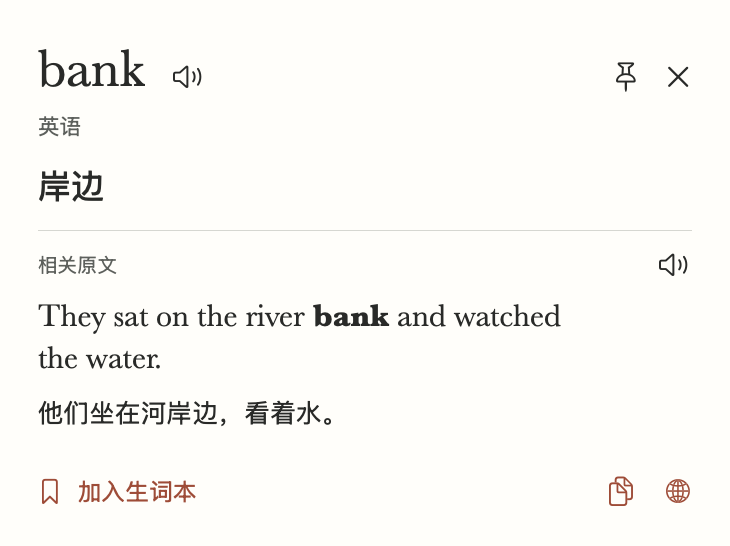
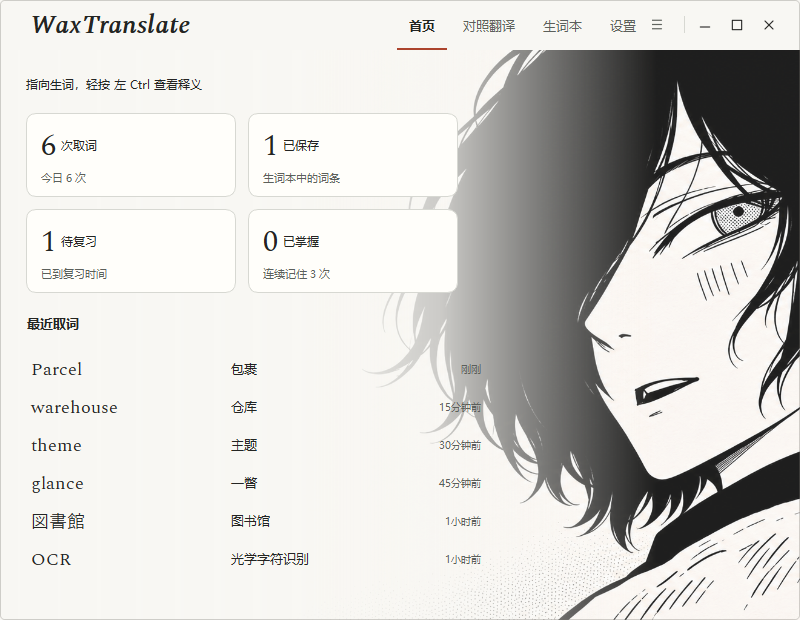
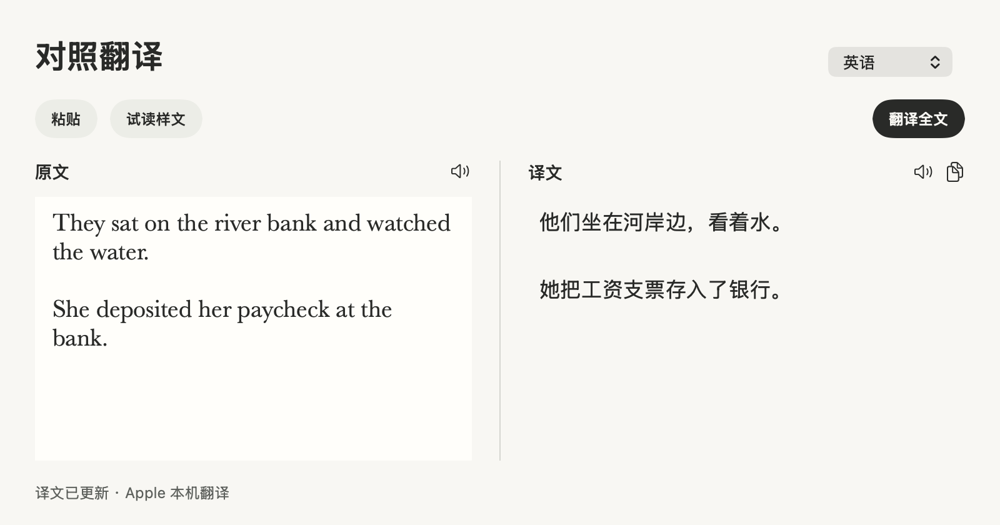
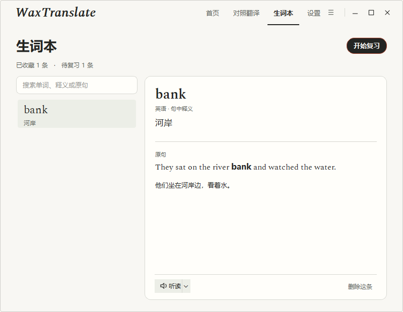

# WaxTranslate · 我靠翻译

在网页、PDF 或其他应用里读外文时，把鼠标指向生词，按一下快捷键，就能看它在原句里的意思。比如同一个 `bank`，读河边的故事时可以查到「岸边」，读存款的例句时可以查到「银行」。也可以框选整段翻译，或把词和原句一起存进生词本复习。

| 开发版 | 查鼠标下的词 | 翻译一段 |
| --- | --- | --- |
| Windows 11 x64 | 轻按并松开左 Ctrl | 按住取词键，用鼠标左键拖选 |
| macOS 15.2 及以上 | 轻按并松开 Option | 按 ⌥⇧R 后拖选 |

## 界面预览

在 macOS 取词卡上看词义和原句，在 Windows 首页查看最近取词与待复习数。点击截图可看原图。

<a href="Assets/Previews/public-trial/macos-lookup.png"></a>
<a href="Assets/Previews/public-trial/windows-home.png"></a>

<details>
<summary>查看 macOS 对照翻译和 Windows 生词本</summary>

Mac 阅读页把两段原文与各自的译文并排显示。Windows 生词本保留收藏时的原句，可从右上角开始复习。

<a href="Assets/Previews/public-trial/macos-reading.png"></a>
<a href="Assets/Previews/public-trial/windows-notebook.png"></a>

</details>

## 本轮修复（2026-11-11）

已补本次核查中七项问题的修复与回归，并继续修复长句点词：本机 16 个真实查询与 1 个无属性接口查询通过，长句 bank 能区分河岸和银行。查看[长句修复与本地验收](docs/verification/long-context/README.md)及[其他修复结果](docs/verification/public-trial-fixes/README.md)。分支、PR 与后续 CI 状态在 [Issue #102](https://github.com/wax0629/WaxTranslate/issues/102) 跟踪；本次尚未公开发版，下方下载与便携包验收仍为修复前基线。

## 试用状态（2026-11-11）

目前提供开发版。Windows 11 x64 有通过桌面回归的便携包，下载需要登录 GitHub。Mac **0.3.0 build 17** 可从源码安装。普通用户公开试用所需的安装包、已知问题与实机验收见[公开试用前检查](docs/verification/public-trial-2026-11-11.md)。

Mac 已通过 160 项共享断句检查、22 项 Vision 检查、12 类原生卡片布局、真实 Apple 翻译及 Release 构建。最新 Windows 便携包在 100% 和 150% 两档各通过 **120/120** 项桌面检查，另通过 2 项原生 OCR 截图和 16 项识别路由检查。[Windows 便携包验收](docs/verification/windows-regression/README.md) · [双端断句验收与截图](docs/verification/sentence-boundaries/README.md)

完整外语句中的普通词和专业术语自动显示同范围原文与译文，中文语境点击才句译。跨行先区分段落、列表、标题、代码和注释，疑似裁切最多补采一次；仍不完整时明确显示片段，不补造原文。任意第三方应用的全部物理手势、人工听感/读屏和真实历史词本升级继续独立跟踪。[当前翻译逻辑](docs/translation-logic.md)

## 当前开发进度

双端支持对照阅读、生词复习、真实统计与最近查询，采用统一纸色、字体层级与简洁卡片。**外语自然句中的普通词和已确认术语/名称自动显示适长原文与对应译文；中文语境中的英文词由用户点击才句译。** 原文内其他术语按确切位置点击，注释去掉行首 // 且不接相邻代码，标题提供整译，路径/片段与未知名称保留边界。[翻译逻辑图](docs/translation-logic.md) · [开发与验收记录](docs/development.md)

Mac 使用 Vision 和 Apple 本机翻译，Windows 使用本地 OCR 和离线模型，语言包分别管理；两端不要求译文逐字一致。

## WaxTranslate Windows 桌面版

**使用便携包。** 登录 GitHub 后下载便携包，解开下载文件，再完整解开其中的 ZIP，双击 `WaxTranslate.exe`。程序默认在系统托盘待命；点击托盘图标或再次双击启动器可打开主窗口。[下载已验证的 Windows x64 便携包](https://github.com/wax0629/WaxTranslate/actions/runs/42843354986/artifacts/13778150668) · [交付记录](https://github.com/wax0629/WaxTranslate/issues/96) · [Windows 构建列表](https://github.com/wax0629/WaxTranslate/actions/workflows/windows-desktop.yml)

- **查词与框选**　轻按左 Ctrl 查一个词，或从顶部应用菜单、托盘菜单进入「框选翻译」。游戏占用左 Ctrl 时，可以在「设置 → 屏幕取词键」改用右 Ctrl，或选「仅应用内查词」。
- **语言包**　英语、日语、韩语随包提供。法语、德语、西班牙语、意大利语、葡萄牙语和俄语可在「设置 → 语言包」下载，安装后即可离线使用；已装包可在同处选择「修复语言包」重新校验和下载。
- **阅读与复习**　在「对照翻译」粘贴文章，点词看释义，按 Ctrl+Enter 看整段译文。在取词卡上点「加入我的生词本」，以后可以按原句复习。[Windows 使用指南](docs/windows.md)
- **任务栏显示**　在「设置 → 启动与窗口」切换「在任务栏中显示」，默认开启。开启时最小化留在任务栏，关闭时收起到托盘；切换立即生效并保留到下次启动。

### 从源码运行

在 Windows 11 x64 安装带 `py` 启动器的 Python 3.12 x64，然后在仓库根目录运行。首次安装需要联网下载依赖和默认模型。

```powershell
.\windows\setup.cmd
.\windows\start.cmd
```

## macOS 安装和运行

在装有 Swift 6 和 macOS 26.4 或更新 SDK 的 Mac 上，从仓库根目录构建安装。应用显示名为「我靠翻译」，磁盘文件名沿用 `waxtranlate.app`。

```sh
./scripts/install.sh
open "$HOME/Applications/waxtranlate.app" --args --show
```

1. 在「设置 → 屏幕取词」查看权限；跨应用取词需在系统设置的「屏幕与系统音频录制」中允许「我靠翻译」，按系统提示重新打开。
2. 指向原文，轻按并松开 **Option** 查词，或按 **⌥⇧R** 后拖选；Esc 取消。组合键输入、拖动或长按 Option 不触发查词。可改为 ⌥⇧T / R、⌃⌥T / R 或仅应用内模式，保留已有显式选择。连续 `rule out`、`run out of`、`look up` 按整组解释。
3. 在「对照翻译」粘贴文章，双击原文查词，点「翻译全文」或按 ⌘Enter 翻译。卡片可听读、固定、展开语境、复制和收藏。
4. 首页查看实际取词统计及最近六条；在「生词本 → 到期复习」复习收藏。设置可选择源语言、下载 Apple 语言包、控制「在 Dock 中显示」。默认在菜单栏待命。[Mac 使用与开发指南](docs/macos.md)

安装脚本会退出正在运行的旧版、复用签名并保留生词本。请保留 `~/Library/Application Support/waxtranlate/BuildSigning` 中的签名材料。从旧版临时签名升级后，如果仍显示未授权，请在「屏幕与系统音频录制」中移除旧条目，重新添加当前应用并重启。正式安装包覆盖已有真实生词记录的验收仍在跟踪。[macOS 升级记录](https://github.com/wax0629/WaxTranslate/issues/1)

## 验证

Windows 的离屏回归、独立桌面回归、多语 OCR 专项，以及 macOS 的 Vision 和 Apple 翻译检查，均有对应命令和运行条件。[复现验证](docs/development.md#复现验证)

[Windows 回归测试集](docs/verification/windows-regression/README.md)集中提供61条用户用例、固定输入、预期结果、CSV表和按组执行入口，并区分自动检查与待人工验收。

当前句译触发规则见 [翻译逻辑](docs/translation-logic.md)。
