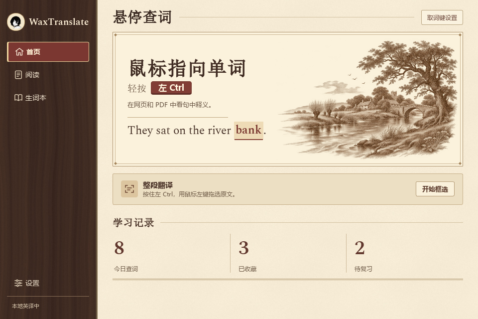

# WaxTranslate · 我靠翻译

在网页、PDF 或其他应用里读外文时，把鼠标指向生词，按一下快捷键，就能看它在原句里的意思。比如同一个 `bank`，读河边的故事时可以查到「岸边」，读存款的例句时可以查到「银行」。也可以框选整段翻译，或把词和原句一起存进生词本复习。

| 开发版 | 查鼠标下的词 | 翻译一段 |
| --- | --- | --- |
| Windows 11 x64 | 轻按并松开左 Ctrl | 按住取词键，用鼠标左键拖选 |
| macOS 15.2 及以上 | 轻按并松开 Option | 按 ⌥⇧R 后拖选 |

## 试用状态（2026-11-10）

Windows 语境卡片与视觉同步已进入主分支：最终便携包在 100%／150% 下各 107 项桌面检查通过，多语种 OCR 通过。[Windows 试用包与验收](https://github.com/wax0629/WaxTranslate/pull/87)。

Mac 0.3.0 build15 已完成本机规则、真实英中／日中、数据兼容与七类原生卡片布局检查，并同身份覆盖安装。卡片区分普通词、名称、中文多术语混排及未知代码；中文语境按需句译、原文术语可点击、注释不接相邻代码。[Mac 规则与界面验收](docs/verification/card-rules/README.md)。Mac #85 依赖 #80，尚未合入主分支。

可以进入开发版试用；自动验收覆盖记录中的样本与流程。任意第三方应用的取词准确率、人工听感、屏幕阅读器和真实历史词本升级继续由[路线图 #3](https://github.com/wax0629/WaxTranslate/issues/3)跟踪。[当前试用边界](docs/verification/macos-sync/trial-readiness.md)。

## 当前开发进度

Windows 主分支已交付多语种离线翻译、对照阅读、生词复习和查词看板。macOS 本轮同步分支为 **0.3.0**：补齐首页四格统计、最近取词、对照阅读、紧凑取词卡与设置，接通已验收的英语短语修复，并改进孤立英文词语种判断。Mac 继续使用 Vision 和 Apple 本机翻译，系统语言包与 Windows 模型分别管理。[Mac 同步 #78](https://github.com/wax0629/WaxTranslate/issues/78) · [开发进度与验收记录](docs/development.md) · [双端路线图](https://github.com/wax0629/WaxTranslate/issues/3)



## WaxTranslate Windows 桌面版

**使用便携包。** 登录 GitHub，打开一次成功的 Windows 桌面构建，在运行页底部的 Artifacts 下载 `WaxTranslate-Windows-x64`。解开下载文件，再完整解开其中的便携 ZIP，双击 `WaxTranslate.exe`。程序默认在系统托盘待命；点击托盘图标或再次双击启动器可打开首页。[已验证的构建](https://github.com/wax0629/WaxTranslate/actions/runs/42459577744) · [Windows 构建列表](https://github.com/wax0629/WaxTranslate/actions/workflows/windows-desktop.yml)

- **查词与框选**　轻按左 Ctrl 查一个词，或在首页点「框选翻译」。游戏占用左 Ctrl 时，可以在「设置 → 屏幕取词键」改用右 Ctrl，或选「仅应用内查词」。
- **语言包**　英语、日语、韩语随包提供。法语、德语、西班牙语、意大利语、葡萄牙语和俄语可在「设置 → 语言包」下载，安装后即可离线使用。
- **阅读与复习**　在「对照翻译」粘贴文章，点词看释义，按 Ctrl+Enter 看整段译文。在取词卡上点「加入我的生词本」，以后可以按原句复习。[Windows 使用指南](docs/windows.md)

### 从源码运行

在 Windows 11 x64 安装带 `py` 启动器的 Python 3.12 x64，然后在仓库根目录运行。首次安装需要联网下载依赖和默认模型。

```powershell
.\windows\setup.cmd
.\windows\start.cmd
```

## macOS 安装和运行

在装有 Swift 6 和 macOS 26.4 或更新 SDK 的 Mac 上，从仓库根目录构建安装。应用显示名为「我靠翻译」，磁盘文件名沿用 `waxtranlate.app`。

```sh
./scripts/install.sh
open "$HOME/Applications/waxtranlate.app" --args --show
```

1. 在「设置 → 屏幕取词」查看权限；跨应用取词需在系统设置的「屏幕与系统音频录制」中允许「我靠翻译」，按系统提示重新打开。
2. 指向原文，轻按并松开 **Option** 查词，或按 **⌥⇧R** 后拖选；Esc 取消。组合键输入、拖动或长按 Option 不触发查词。可改为 ⌥⇧T / R、⌃⌥T / R 或仅应用内模式，保留已有显式选择。连续 `rule out`、`run out of`、`look up` 按整组解释。
3. 在「对照翻译」粘贴文章，双击原文查词，点「翻译全文」或按 ⌘Enter 翻译。卡片可听读、固定、展开语境、复制和收藏。
4. 首页查看实际取词统计及最近六条；在「生词本 → 到期复习」复习收藏。设置可选择源语言、下载 Apple 语言包、控制自动百科补查及「在 Dock 中显示」。默认在菜单栏待命。[Mac 使用与开发指南](docs/macos.md)

安装脚本会退出正在运行的旧版、复用签名并保留生词本。请保留 `~/Library/Application Support/waxtranlate/BuildSigning` 中的签名材料。从旧版临时签名升级后，如果仍显示未授权，请在「屏幕与系统音频录制」中移除旧条目，重新添加当前应用并重启。正式安装包覆盖已有真实生词记录的验收仍在跟踪。[macOS 升级记录](https://github.com/wax0629/WaxTranslate/issues/1)

## 验证

Windows 的离屏回归、独立桌面回归、多语 OCR 专项，以及 macOS 的 Vision 和 Apple 翻译检查，均有对应命令和运行条件。[复现验证](docs/development.md#复现验证)
