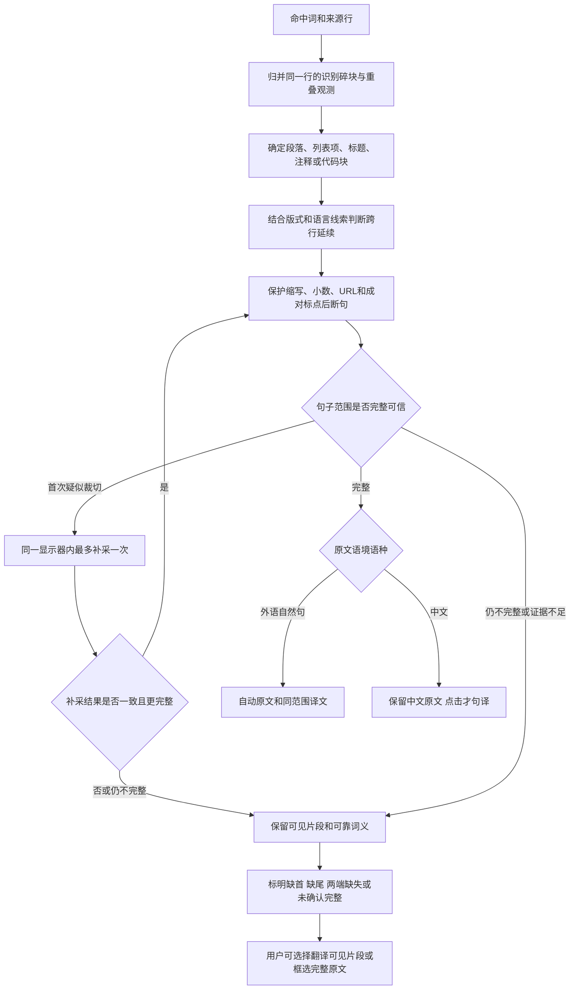

# 换行、断句与原文片段

屏幕上的一行可能只是句子的一部分，也可能属于标题、列表、代码或另一栏。程序保留来源行和命中词位置，按下面的顺序选出相关原文。实施与双端验证由 [#90](https://github.com/wax0629/WaxTranslate/issues/90) 跟踪，Mac 验收通过后同步 Windows。

同行归并只接受正常字词间距或有位置佐证的重复词；栏间空隙和独立短标签保持分开。跨行要同时考虑行距、字号、缩进、当前结构和语言延续线索，不能仅凭“挨得近”拼接。明确的新列表项、空行、标题、代码和明显段落边界会停止归并。列表续行仍属于同一项。

行首 `//`、`///`、`//!` 不参与原文和翻译；OCR 将标记误认成近似符号时，须有邻近注释或代码佐证才去除。URL 内部的斜杠保留。词在跨行处遇到软连字符时可合并；真实硬连字符保留，避免凭拼写猜测并改写原文。

完整性与结构分别保存。原文片段可以来自普通段落或列表；它不会因为查到了词典/术语解释而被升级为完整句子。独立词条没有句子结束标点也能正常查词，不重复显示原文或触发补采。关闭卡片、更换查询或取消时丢弃过期结果；补采识别成另一个词时保留初次片段。

自动补采限于同一显示器的局部区域：首次最多 900×180 逻辑点，必要时一次扩展至最多 1200×480。仍不可见的文字不会被补造。缺少标点和排版证据的情况会明确保持未确认；这是一套有界的证据规则，不承诺理解任意文档的全部语义。

相关原文、精确位置、完整性和对应译文一同用于显示、收藏与复习。节选只翻译同一节选，不能把片段译文附给完整原句；缓存隔离完整与不完整范围。旧词本字段和复习进度保留。[验收语料与复现](verification/sentence-boundaries/README.md)
