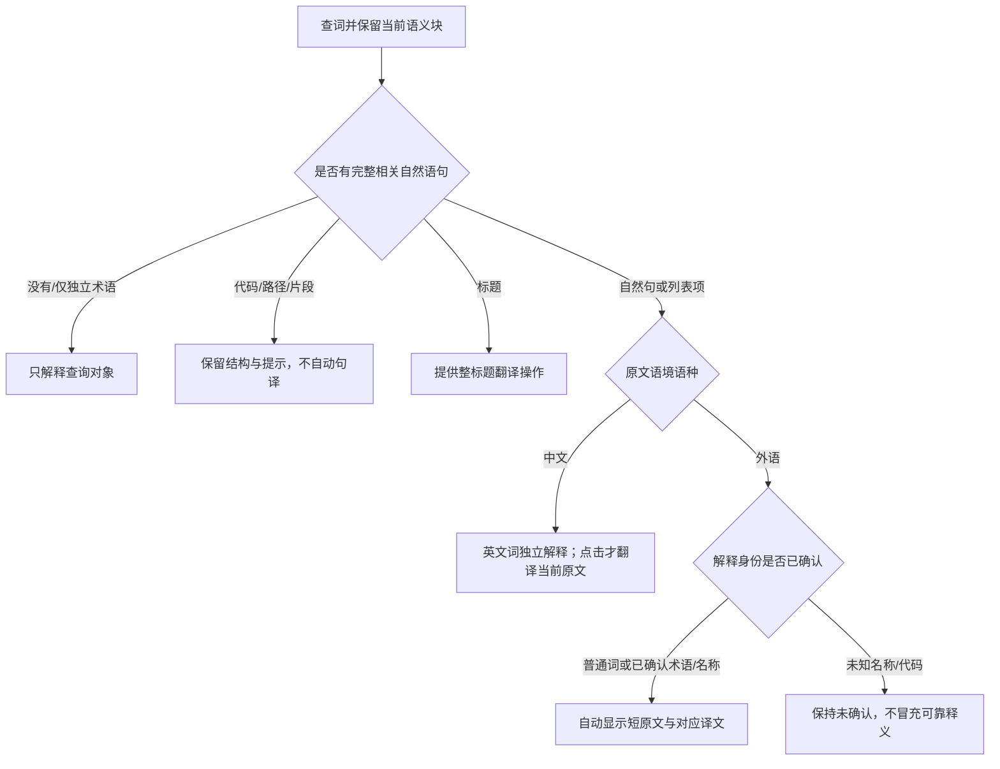

# 当前翻译与原文对照规则

2026-11-10 用户修订，跟踪 #88。句译由**原文语境的语种**决定，专业术语命中本机资料不再成为隐藏外语原文或阻止自动句译的理由。

| 场景 | 主解释 | 原文与句译 |
| --- | --- | --- |
| 外语自然句/自然语言列表中的普通词、已确认名称或术语 | 保留词义、身份说明和来源 | 自动显示适长原文及同范围译文 |
| 中文语境里的英文普通词、术语或名称 | 中文解释，词头按英语朗读 | 短中文原文按场景显示；用户点击后才附句译 |
| 已知术语单独出现，无相关句子 | 立即给出术语解释 | 不重复原文，不额外启动整句翻译 |
| 标题、代码/路径、身份未确认名称、不完整识别片段 | 保留既有身份/结构和保守提示 | 标题提供明确整译操作；代码/路径和片段不自动当作完整句子翻译 |
| 框选、全文翻译或显式整标题翻译 | 用户指定范围的译文 | 按明确选择的范围翻译 |

解释与句译分别保留来源和状态；句译失败不清空已有术语解释，可以重试。长原文节选必须配同一范围的译文，展开后才显示完整块对应译文；收藏不会把节选译文附给完整原文。切换查询、取消或关闭后丢弃旧请求。百科继续手动查询。

macOS 从光标命中的那一次出现判断专义。「按住 Shift」和「Command + Shift + P」里的 Shift 有按键动作或组合键作依据，班次说明里的 shift 按普通词查询。同一句比较电力和模型里的 transformer 时，分别使用各自分句的线索。原文如果直接写「这里的 Canary 指的是少量试用实例」，卡片可以引用这段定义，词表无需预先收录 Canary。领域线索不足或冲突时继续普通查询。

## 原文完整性门（#90）

句译判断之前增加“同行碎块归并 → 结构块与跨行归并 → 语言断句 → 完整性”门禁。缺句首、缺句尾、两端缺失或证据不充分时，保留可见片段和独立词义，禁止自动句译；显式“翻译可见片段”仍可使用。裁切先尝试一次有界补采，取消后丢弃结果。独立词条不需要句子结束标点，框选/全文仍按用户指定范围翻译。[详细规则](sentence-boundaries.md) · [双端本轮进度](https://github.com/wax0629/WaxTranslate/issues/90)。
