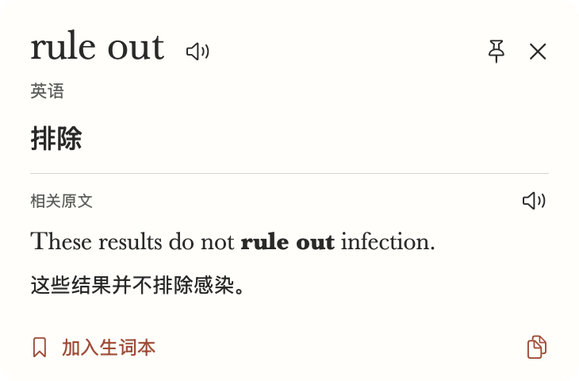

# macOS 悬停取词反馈

2026-11-12，Intel Core i7-9750H，macOS 26.6.2，Swift 6.3.3 / SDK 26.5，已安装 Apple 英中翻译包。两个 Release 来自相同的 #103 代码。基线 `5f3ca1a` 增加取词计时与受控样文，优化版为 `9608988`。

每版启动三个独立进程，每个进程常驻 6 秒后，交替查 `rule out` 和 `results` 共五次。按旧、新、新、旧、旧、新的顺序运行。使用真实屏幕、准确模式 Vision 和实际卡片，逐次核对词头和完整原句。时间从与 Option 共用的取词回调开始，到 AppKit 将等待卡排到屏幕上或把词头装入可见窗口。进程首查不等于重启机器后的冷启动。

| 观察项（中位数） | 基线 | 优化版 |
| --- | ---: | ---: |
| 首次可见反馈（进程首查，3 次） | 988.5 ms | 97.6 ms |
| 出现正确词头（进程首查，3 次） | 988.5 ms | 600.4 ms |
| 识字耗时（进程首查，3 次） | 626.2 ms | 339.8 ms |
| 首次可见反馈（随后换词，12 次） | 557.4 ms | 20.5 ms |
| 出现正确词头（随后换词，12 次） | 557.4 ms | 467.1 ms |
| 识字耗时（随后换词，12 次） | 302.1 ms | 284.9 ms |

| 进程 | 等待卡累计毫秒，按查询顺序 | 词头累计毫秒，按查询顺序 |
| --- | --- | --- |
| 基线 1 | 直接显示词头 | 1003.1、766.3、513.1、563.9、537.0 |
| 优化 1 | 100.7、28.6、20.6、17.5、20.3 | 621.9、470.7、429.8、461.1、465.5 |
| 优化 2 | 97.6、25.7、18.1、19.8、21.0 | 593.8、439.7、445.3、545.4、542.5 |
| 基线 2 | 直接显示词头 | 986.8、751.5、507.7、556.9、530.1 |
| 基线 3 | 直接显示词头 | 988.5、806.7、511.8、575.6、557.9 |
| 优化 3 | 96.6、27.1、23.2、19.2、18.7 | 600.4、453.0、507.5、488.3、468.6 |

同一个词和原句在后续查询中可以命中译义缓存，屏幕取词每次仍会截图和识字。计时不包含人的按键时长和显示器的逐帧扫描。

## 真实窗口回归

等待时关闭会取消查询。用等待卡与黑色选择面板同时盖住样词，结果在原窗口显示 `rule out`、原句和「排除」。另外核对了快速换词、捕获途中关闭、拖选结束后的识字、空白处提示和等待阶段的最近记录。下图来自隔离配置中正在显示的卡片，仅含固定样文。




## 复现

在已授权屏幕录制且安装英中翻译包的 Mac 上执行。第一条命令使用临时签名包与独立偏好，运行完自动清理，参数指定保存截图的目录。

```bash
./scripts/check-hover-feedback.sh dist/hover-feedback-check
./scripts/check.sh
./scripts/check-card-layouts.sh
swift build -c release -j 2
```

对对应提交的签名 Release 重复下列查询，设置 `app` 为要测的应用包。让测试样文保持可见。

```bash
app="$HOME/Applications/waxtranlate.app"
profile="WaxTranslate.Test.Series.$(uuidgen)"
log="$(mktemp -t wax-lookup)"
open -n -g -W --stderr "$log" "$app" --args --test-profile "$profile" --test-hover --test-hover-series --trace-lookup
rg 'lookup\.(pending_shown|card_shown|complete)' "$log"
defaults delete "$profile"
```

本轮未逐一测试第三方应用的物理 Option 手势、其他 Mac 硬件及不同系统负载。
