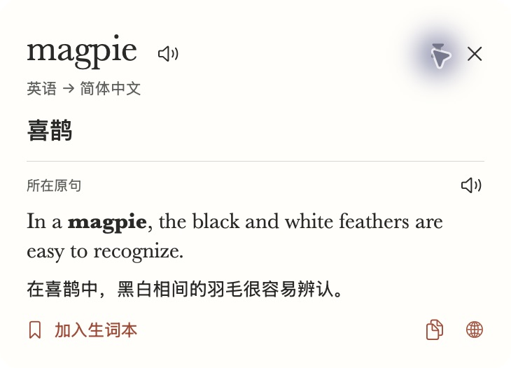
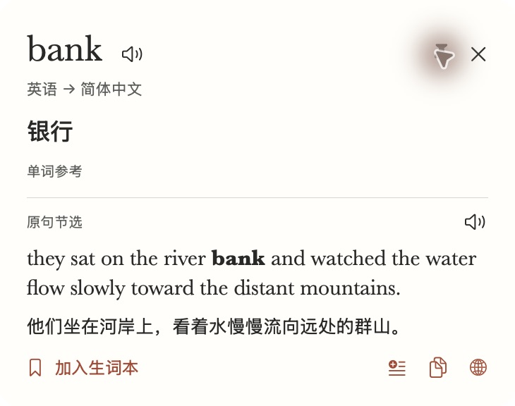
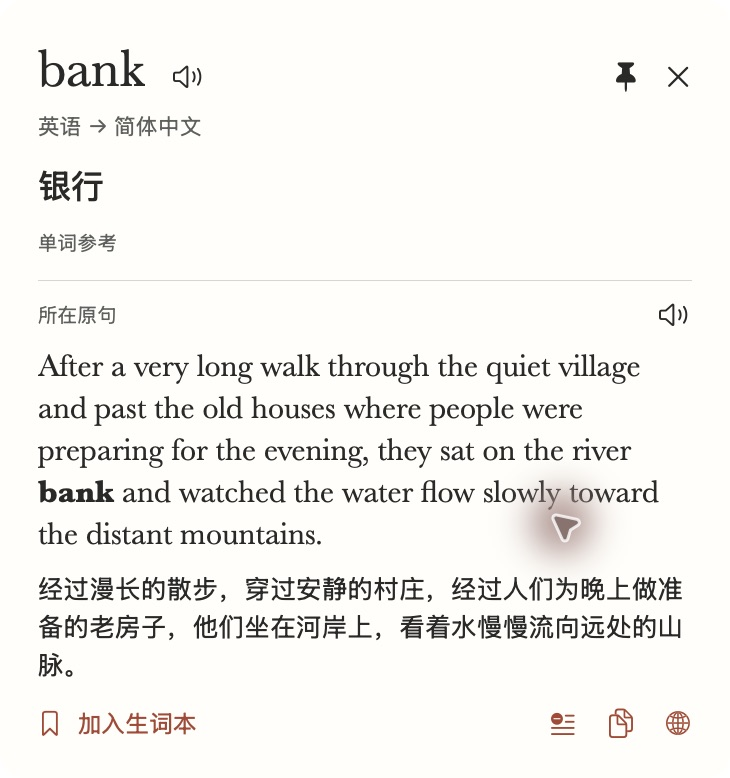
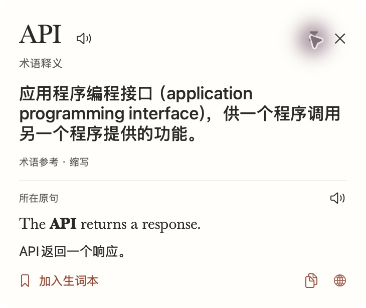
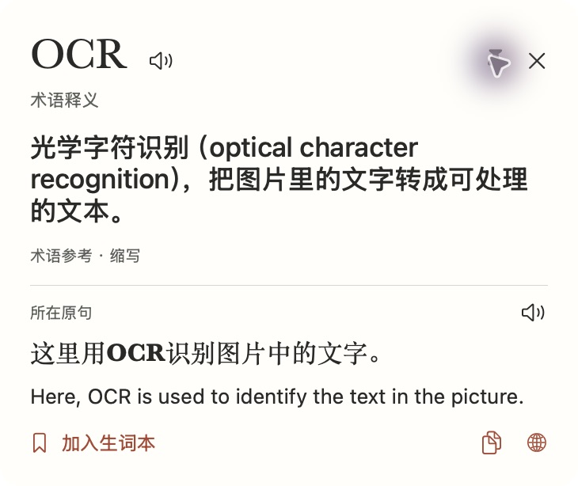
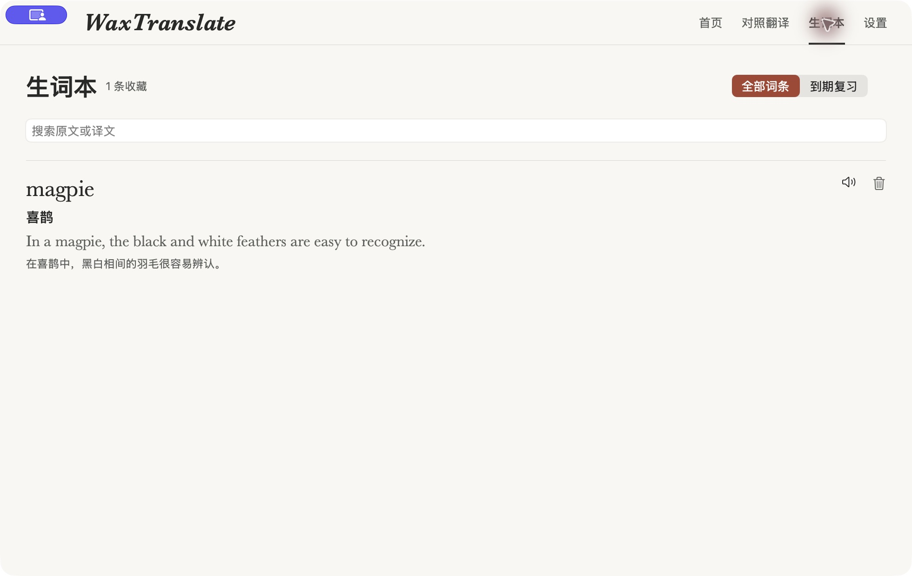

# macOS build 11：译词边界与默认原句对照

2026-11-09，接续 Issue #78 / PR #80。本机 macOS 26.6.2 / Intel、Swift 6.3.3 / SDK 26.5，安装版 0.3.0 build 11。当前验证提交和远程 CI 以 PR 正文为准。

用户报告 magpie 主释义多了「中」。真实 Apple 翻译对 `In a magpie, the black and white feathers are easy to recognize.` 把 `喜鹊中` 标成所选词，对 `Among the magpie population, this behavior is common.` 又把 `在喜鹊` 标成所选词；原实现直接采用标记范围，带入了相邻成分。用户原始查询也已在正常配置中重新查询，显示「喜鹊」和完整原句对照。公开截图只使用隔离固定样文，原始记录中的个人信息不进入证据。

修复对中文边缘虚词用词典或独立词译交叉核对，要求词义对应完整词边界，且范围外只有功能成分；核对失败就保留明确标注的独立参考，不直接裁掉「中」或其他字。句中取词默认显示双语原句，短句不再需要展开。长句优先取命中词所在的适长分句，否则按完整单词围绕确切位置截取约 180 字符（中文约 90 字符），单独翻译同一节选；展开查看完整原句和句译。

| 验证项 | 预期 | 实际结果 | 结论 |
| --- | --- | --- | --- |
| magpie 边界 | 主释义不混入句子位置成分 | 上述两种污染和普通花园句均返回「喜鹊」；正常用户原始记录重查也为「喜鹊」，未自动改写其他历史 | 本机真实服务 + UI 通过 |
| 合法字形 | 不用删后缀破坏词义 | 中国、进行中、的确保留；中医、地中海不能被拆成任意内部参考；喜鹊种群中的实词不能当成虚词直接删掉 | 自动边界回归通过 |
| 默认双语 | 无需展开即可看到同一原句的中英对照 | magpie 词头强调、主释义和两种语言直接可见，短句没有冗余展开按钮 | 实际 UI 通过 |
| 长句与位置 | 节选包含真正命中词，可看完整对照 | 长 bank 样文从正确分句开始，展示对应节选译文；展开后显示完整原句及完整句译。句首/句尾、两个同词的不同位置、中文与 emoji 的 UTF-16 偏移、短语 anchor 保留回归通过 | 自动 + UI 通过 |
| 已知术语 | 术语解释即时可用，原句自动翻译 | API 默认显示英语原句及中文句译，OCR 中文语境默认附英文句译，主释义仍为本机解释 | 实际 UI + 真实服务通过 |
| 收藏与缓存 | 不把节选译文配到完整原句上 | magpie 收藏后词本读回完整原句和句译；长句的两份译文分别保留，不完整的长句结果不进入缓存，重查可重试 | UI 保存 + 自动缓存回归通过 |
| 构建与安装 | 检查通过，原用户数据保留 | `./scripts/check.sh`、Release、覆盖安装、codesign strict 通过；隔离域备份清理，恢复正常配置，只对原始 magpie 做了一次实际重新查询，未导入合成词条 | 本机通过 |

边界：Apple 有时完全丢失词语强调。例如本次长 bank 样文主结果仍可能回退为「银行 · 单词参考」，而句译正确描述河岸。该结果明确是独立词义，不能当作该长句的语境释义已通过；本轮不宣称解决全部模型消歧。既有短句两种 bank、短语否定、失配回退、英中与日中服务回归继续通过。完整句译单独失败时保留可用的节选和主释义，展开提示缺失；这一异常的缓存边界有自动测试，未人工模拟系统服务中断。

复现：

```sh
./scripts/check.sh
./scripts/install.sh
python3 scripts/prepare-ui-profile.py --profile WaxTranslate.Test.context-check --scenario context
open -g --stderr /tmp/wax-context-timing.txt "$HOME/Applications/waxtranlate.app" \
  --args --test-profile WaxTranslate.Test.context-check --show --trace-lookup
```

依次查 magpie、bank、API、OCR。magpie 无需展开即可对照；bank 默认节选，点击「展开完整原句」后看完整双语；API/OCR 自动附原句译文。测试结束先退出应用，再删除上述专用偏好域，正常启动应用。所有夹具数据均为合成，不代表真实历史。阶段日志只含名称与毫秒，不含原文。








build 10 的字号继续保留：词头 27pt、释义 17pt、原句 16pt、句译 13pt。此前[术语与字号记录](terminology.md)中「按需展开句译」属于 build 10 的历史行为，以本页 build 11 默认双语行为为准。Windows 产品代码未改，本轮不重跑 Windows 桌面测试。
