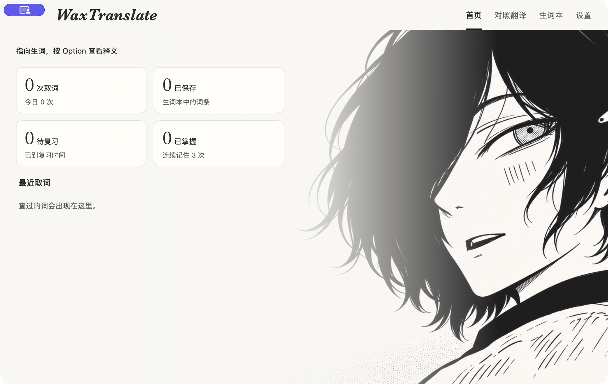
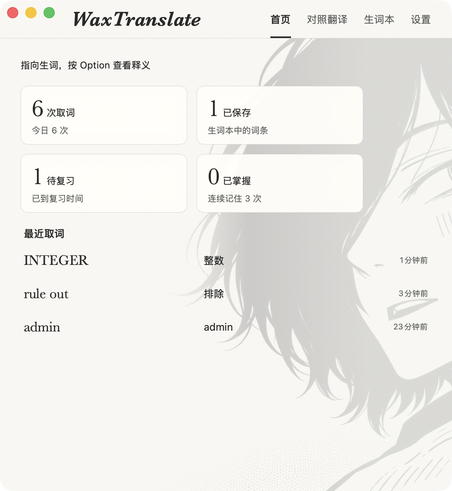
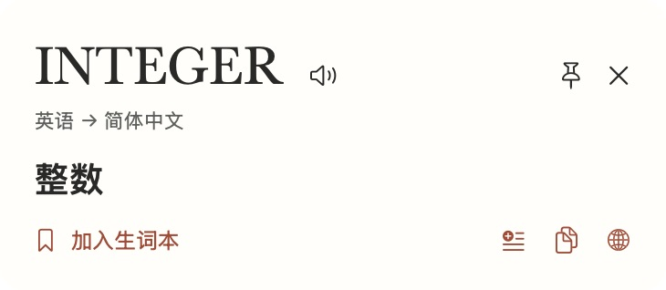
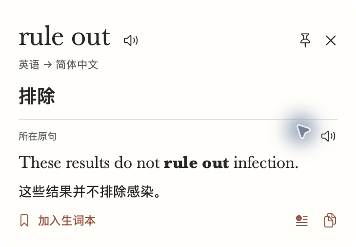
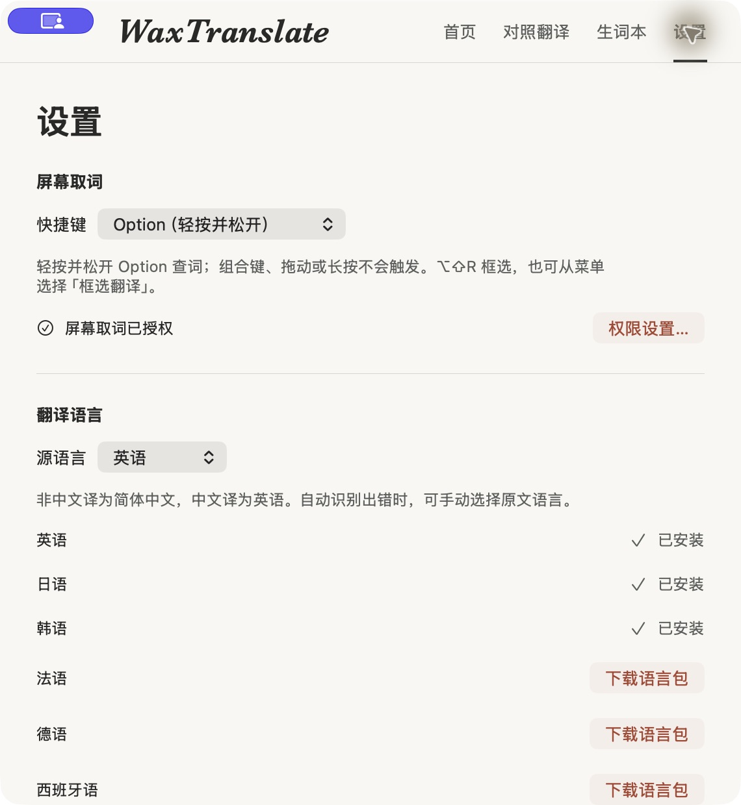
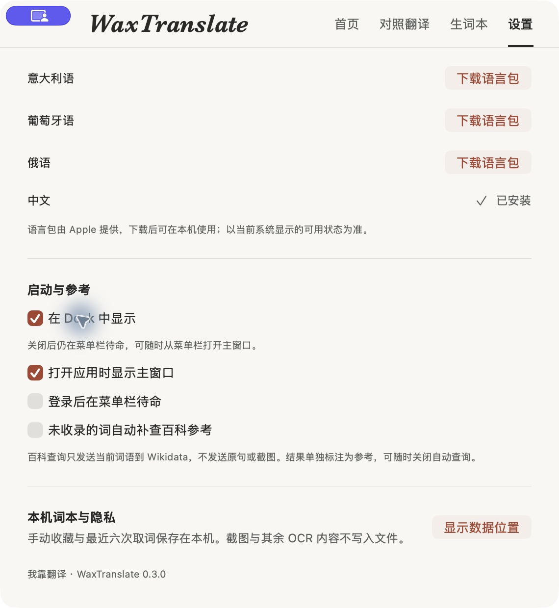
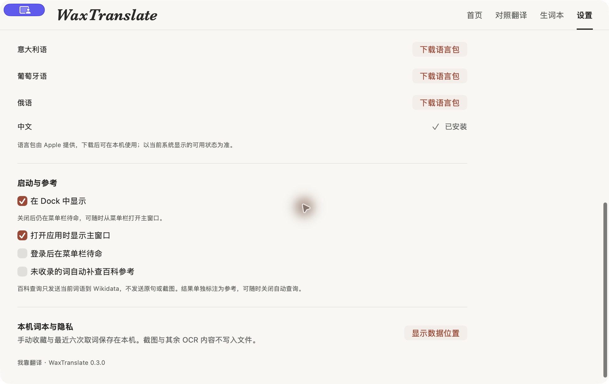
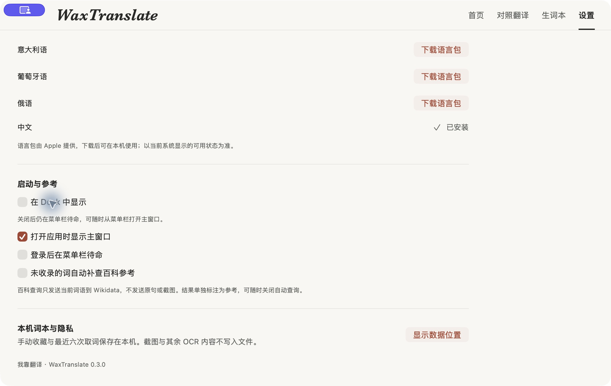

# macOS 0.3.0 build 9 追加验收

2026-11-09，环境仍为 macOS 26.6.2 / Intel、Swift 6.3.3 / SDK 26.5，使用已安装的 Apple 英中及日中资源。接续 Issue #78、#79 和同一 PR #80；最终提交与当前 head 的 CI 在 PR 正文记录。

用户追加范围：修正图标、保持四张统计卡两排两列并平衡卡片及人物留白、默认单独 Option、把 Dock 显示做成设置、删除页面重复的框选/对照入口、处理 Codex 取词失败与繁体字，并实测响应各阶段。

| 验证项 | 预期 | 实际结果 | 结论 |
| --- | --- | --- | --- |
| 统计与入口 | 两排两列、宽窄可读、没有重复按钮 | 980pt / 570pt 真实窗口；卡片上限 210pt、列间距 12pt；首页及词本空状态不再重复放置入口；顶部导航仍在，原生菜单可进入框选 | 本机界面通过 |
| Option 默认与防误触 | 新配置为 Option；保留旧选择；组合输入不触发 | 设置实际显示 Option；用户在 Codex 确认触发并提供 INTEGER 译义截图；单测覆盖字母、鼠标、长按、其他修饰键、计数溢出与切换模式清理 | 真实触发和自动状态回归通过；自动工具拒绝单独修饰键注入，不算物理组合手势全量验收 |
| Dock | 即时切换、窗口保留、跨重启保留 | 0→1 后同一设置窗口保留；退出后带同一隔离配置重启仍为 1；关闭为 0 后窗口继续可用；原生退出正常 | 本机实际操作通过 |
| 图标 | 应用与菜单栏采用当前漫画图标 | 打包资源复核、同身份签名安装通过；应用显式设置运行时图标，菜单栏不再使用旧书本 SF Symbol | 资源与运行路径通过；未把 Finder/Dock 缓存视觉检查记作独立截图证据 |
| 真实截图链路 | 指针不遮字、Retina 与显示器局部坐标正确 | 受控原生窗口真实显示样文，通过 ScreenCaptureKit → Vision → 连续短语 → Apple 翻译，得到 rule out「排除」，句译保留否定；保存后 UI 读回 | 本机真实屏幕路径通过，非纯生成位图测试 |
| 小字与空白 | 中英混排可命中，空白不选邻词 | 12/14/18pt、深浅背景，分别检查 Codex/English/Option 共 18 个词落点；六组空白拒绝；另外验证光标排除、1×/2×、负坐标屏幕和裁切边缘 | 自动回归通过，不外推全字体准确率 |
| 简体一致性 | 词义、句译、全文、参考和保存都用简体 | 实际 INTEGER 卡片显示「整数」；词典「整數」、全文、保存读回、旧显示与 Wikidata 解析的转换回归通过；英语目标和日文原字保留反例通过 | 本机 UI 与自动回归通过 |
| 缓存 | 同语境重复快，不混淆位置或语种 | 实际重复 rule out 命中缓存；自动覆盖不同 bank 位置、不同语种、LRU 淘汰、十分钟过期与超长输入拒绝 | 通过；仅内存 64 条、十分钟，原文不写入诊断 |
| 菜单框选与取消 | 移除页面按钮后入口仍可达 | 从原生菜单进入真实框选遮罩，Esc 取消后回到原设置页 | 实际进入/取消通过；完整鼠标拖选成功路径仍沿用待手动清单 |
| 最终检查与安装 | 本轮源代码回归与 Release 正常 | `./scripts/check.sh`、Release、覆盖安装及 `codesign --verify --strict` 通过；未改 Windows 产品代码 | 本机通过；远程结果见 PR 当前 head |

截图使用正常用户空首页，或 `WaxTranslate.Test.*` 隔离域中的受控样文及交互试验；其中次数不代表用户历史。测试域已备份后清理，正常词本未导入测试条目。最终恢复正常用户首页。最初 Codex 的未命中由用户报告，工具禁止直接读取 Codex 自身窗口，因此不声称独立复现其精确根因；用户随后提供了能识别 INTEGER 的截图，本轮进一步用受控真实屏幕和小字样本验证截图与命中路径。

## 分阶段耗时

以下为单机观测，非性能保证。进程首查不等于重启机器后的冷环境。不同文字、窗口内容、系统负载和语言包会改变结果。

| 验证项 | 预期 | 实际结果 | 结论 |
| --- | --- | --- | --- |
| 固定 INTEGER 样句，同会话三次 | 分离准备和首次推理 | 准备 63.5/48.0/38.2ms；整句推理 4726.3/726.2/613.2ms | 首查主要在 Apple 推理，不在准备调用 |
| 固定样句，每次新会话 | 检查是否每张卡都必然冷启动 | 准备 39.5/34.5/38.2ms；整句推理 1109.8/293.1/304.0ms | 新会话不等于必然重新冷载入；存在系统热态 |
| 成功的实际屏幕样文 | 分离捕获与译义 | 退出旧浮窗等待 117.5ms、显示器枚举 120.6ms、截图 220.5ms、OCR 1256.2ms、语言可用性 44.3ms、准备 31.6ms、句译 248.4ms；完整译义在 2492.0ms 完成 | 此成功样本最大单项是 OCR；阶段间还含布局和调度，不能只把列出的时长简单求和 |
| 同词同语境的应用内再查 | 跳过模型工作 | 138.1ms 显示缓存结果，无翻译请求 | 不含重新截图与 OCR 的耗时 |

已采取：悬停取景限制最多 900×180 逻辑点，保留实际像素倍率；已安装英中资源时用固定本机样句后台预热；相同词、原句、语种和精确位置的结果使用有界缓存。仍保留高质量 OCR，未以切换快速识字模型来掩盖准确性损失。

原始脱敏记录：[首查与同会话](timing-same-session.txt)、[新会话](timing-new-session.txt)、[屏幕链路与缓存](timing-screen.txt)。这些文件只有阶段时长及固定基准样句结果，没有屏幕文字或用户原句。

```sh
./scripts/check.sh
./scripts/benchmark-macos.sh
./scripts/benchmark-macos.sh --reuse-session
open -g --stderr /tmp/wax-lookup-timing.txt "$HOME/Applications/waxtranlate.app" \
  --args --test-profile WaxTranslate.Test.capture-check --test-hover --trace-lookup
```

最后一条会显示受控原生测试窗口并完成一次真实截图；仅接受隔离测试域，测试后退出并清理该域。不得将它当作物理 Option 按键验收。未安装语言包的机器应记录跳过，而非通过真实服务。

## 截图










本轮没有重跑 Windows 桌面测试。真实历史词本的正式包升级、朗读声音、VoiceOver、剪贴板独立读回及原生系统控件完整组合，仍按原验收清单保持待验证，不用此次自动回归代替。
