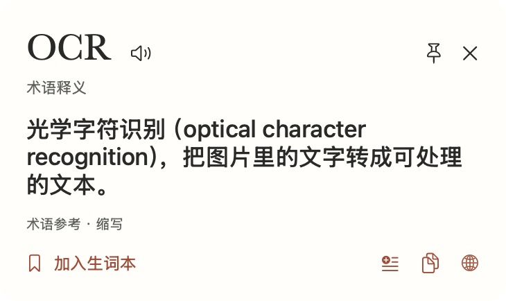
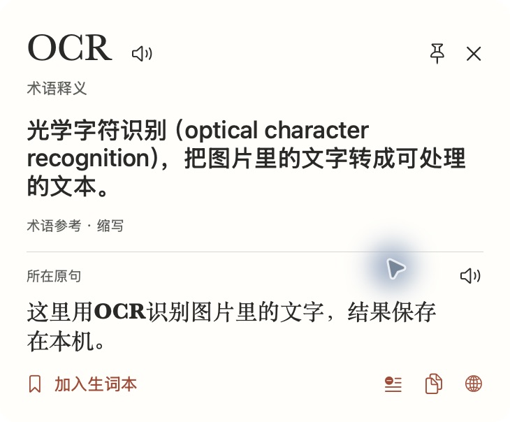
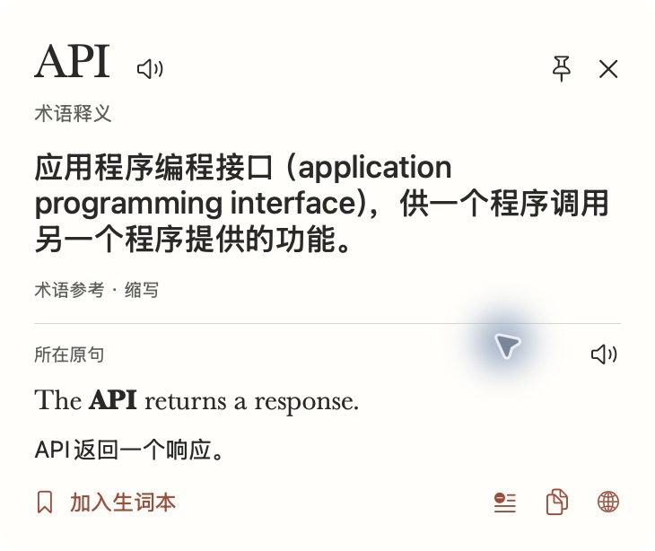
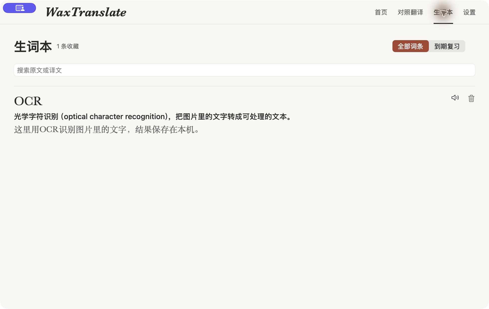

# macOS build 10：混排术语与卡片字号

2026-11-09，接续 Issue #78 / PR #80。本机 macOS 26.6.2 / Intel、Swift 6.3.3 / SDK 26.5，安装版 0.3.0 build 10。验证提交和对应远程 CI 在 PR 正文记录。

用户截图中的 OCR 已被正确取出，但卡片按整句中文选择了中译英，导致主结果原样返回 OCR；词库中原有的「光学字符识别」被 `sourceLanguage == en` 门槛挡住。修复将术语识别与整句翻译方向分开，原句及手动语种不改写。

| 验证项 | 预期 | 实际结果 | 结论 |
| --- | --- | --- | --- |
| 中文混排缩写 | 本机已有解释可用 | OCR/API/SDK/JSON/CPU/BPE、全角 OCR 和复数形回归通过；真实卡片给出「光学字符识别（optical character recognition）」及解释，标「术语释义」 | 自动 + 实际 UI 通过 |
| 名称和多义缩写 | 按局部语境解释，线索不足保守 | Codex 编程/手抄本、Rust/Go 编程语言、React/Docker、PRD 产品/地理，以及两个 MVP 在中文逗号两侧的精确义项通过；繁体上下文辅助匹配不改原文；无明确线索的 Codex 标多义参考 | 自动回归通过，不代表通用专名准确率 |
| 同形反例与位置 | 普通词不被强制套用技术解释 | ram 公羊、rest 休息、Rust 铁锈、葡语 os/OS、法语 AI、印尼语 api、OCR2 和失效选区反例通过 | 自动通过 |
| 回退和缓存 | 原样名称不冒充释义 | 未变化的拉丁名称标未释义，不能写入成功缓存；保存/复制及成功统计均按 isUsable 检查。本机术语优先于旧泛化结果，不沿用旧泛化句译；日中同字「猫」和整段代码原样结果仍有效 | 自动数据边界通过；未声称所有相同字串都无效 |
| 本机与模型的分工 | 已知术语立即可读，原句按需 | OCR 实际卡片无需语言包检查或模型请求即可展开中文原句并收藏；API 英文原句在展开后得到「API返回一个响应。」；百科自动开关为开时本机命中仍未出现自动参考结果 | 实际 UI + 阶段记录通过 |
| 真实 Vision | 混排输出能进入新术语路径 | 16pt 中英位图经真实 Vision 识别得到 OCR，整句仍为中文，随后命中光学字符识别；并重跑既有小字、紧排、跨栏、短语与真实英中/日中服务 | 真实 Vision + 自动回归通过；本项是生成位图，不是跨应用屏幕捕获 |
| 保存与朗读语言 | 原句不丢、词头语言与原句分开 | 实际收藏和生词本读回 OCR 全称/中文解释及中文原句；术语词头选英语，中文原句保留中文，日语词头反例通过，词本与复习调用同一规则 | 保存 UI 及语言选择回归通过；未人工听音 |
| 字号 | 输出卡片小一档且层级清楚 | 词头 30→27pt，主释义 20→17pt，原句 18→16pt，句译 14→13pt；真实 OCR 与 API 长解释及原句截图无裁切，操作按钮可用 | 实际 UI 通过 |
| 构建、安装与隔离 | 检查通过，真实记录保留 | 完整 check、Release、覆盖安装及 codesign strict 通过；两个专用测试域备份后清理，恢复正常配置；未自动改写用户原历史和收藏 | 本机通过；远程以 PR 当前 head 为准 |

本机术语在应用内查询的阶段记录中，OCR 约 91ms 显示、API 约 270ms 显示；不含重新截图与 OCR。API 展开后才出现语言可用性、准备与句译阶段。[脱敏阶段记录](timing-terms.txt)。首次已有用户词条保存的数据不做静默重写，重新查询会使用新解析规则。

复现：

```sh
./scripts/check.sh
python3 scripts/prepare-ui-profile.py --profile WaxTranslate.Test.terms-check --scenario terms
open -g --stderr /tmp/wax-terms-timing.txt "$HOME/Applications/waxtranlate.app" \
  --args --test-profile WaxTranslate.Test.terms-check --show --trace-lookup
```

在隔离首页依次查 OCR、API 等词。OCR 卡片显示解释，展开保留中文原句，可立即收藏并从词本读回。API 展开前只有术语解释，展开后显示英文原句及中文句译。完成后退出应用，再删除该专用测试域。夹具的次数与六条历史都是合成数据，不代表用户实际历史。






未收录名称仍可能缺乏可靠解释；同名百科结果只作参考，不自动挑一个当成确定译义。本轮未改 Windows 产品代码，也未重跑 Windows 桌面测试。原阶段的正式历史词本升级、听音、VoiceOver 等人工验收边界继续保留。
