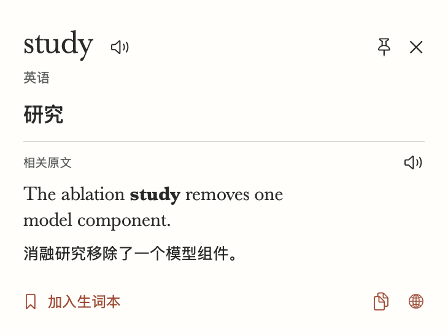
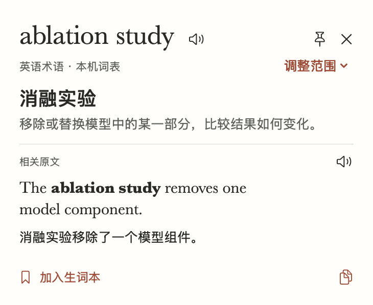
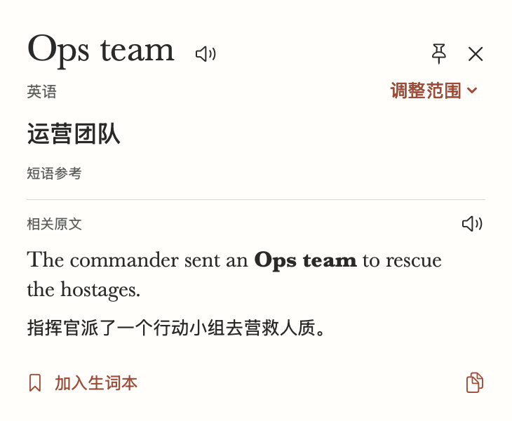
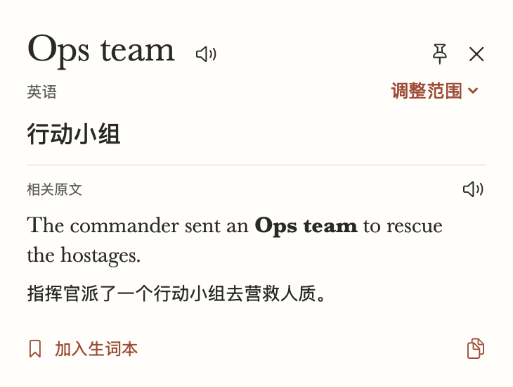

# 点到 study 后出现什么

在「对照翻译」打开试读样文，双击第一句里的 `study`。卡片标题应为 `ablation study`，中文释义是「消融实验」，英语原句加粗这两个词。再双击 `housing`，点「调整范围 → 包含左词 · battery housing」就能用同一句话查「电池外壳」。英文样文在两个平台都可使用。Windows 的试读示例先打开原有的 `bank` 卡片，关闭后可在编辑器里双击其他词。

| 旧版 | 本轮开发版 |
| --- | --- |
|  |  |

## Mac 实测

本机为 Intel Mac、macOS 26.6.2，已安装 Apple 英译中语言包。测试绘制固定英文原句，向真实 Vision 提供同样的像素与落点，装载正式的 SwiftUI 浮窗，在卡片已有首个解释、完成布局后读表。每次先按应用方式预热 Vision 和翻译，首次查询无已识别画面或词义缓存。旧版与新版各启动三次，每个进程连续查三次，运行顺序为旧、新、新、旧、旧、新。计时包含 OCR、范围识别、释义与卡片布局，8 毫秒轮询；使用离屏窗口和合成输入，不包含物理按键、屏幕录制授权或第一次下载语言包。

| 验证项 | 预期 | 实际结果 | 结论 |
| --- | --- | --- | --- |
| 首次出现的解释 | 首张卡直接回答整组在这里的含义 | 旧版 9 次都是「研究」，新版 9 次都是「消融实验」并附中文解释 | 此样例通过 |
| 首查响应 | 分开记录首次与重复查询，比较相同输入 | 首次中位数由 3448 毫秒到 2480 毫秒，各 3 次。旧版的计时终点为单词「研究」 | 单机样例，首查仍有可感知等待 |
| 相同画面重复查 | 记录可读释义的延迟 | 中位数由 134 毫秒到 104 毫秒，各 6 次 | 此样例通过 |
| 实际本地模型 | 手动扩词保留词义，否定句保留否定 | `battery housing` 得到「电池外壳」。`The model did not show emergent capabilities.` 得到「该模型没有显示涌现能力。」 | Apple 本机运行通过 |
| 选择与边界 | 同一拼写按邻近语境判断，重复词按位置识别 | 医疗消融、逗号隔开的单词、不同分句、最长术语和重复词均通过。点击收藏后晚到的句译补入原条目 | 自动回归通过 |

已有词表覆盖九组术语及单复数等形式，来自机器学习、统计与并发编程。显式扩大选区可用于其他英文搭配。术语和释义可在两端离线使用。两端句译分别由系统翻译和本地模型生成，用词可能有差异。术语解释参考 [Google 机器学习术语表](https://developers.google.com/machine-learning/glossary#ablation)及[涌现能力论文](https://arxiv.org/abs/2206.07682)。

## 复现

```sh
./scripts/check.sh
./scripts/check-hover-feedback.sh --phrase-preview dist/phrase-review 801112838f7cc1bf29f962251c5ee628eb16fcc3
./scripts/check-card-layouts.sh dist/phrase-review/layouts
python3 scripts/windows_regression.py check
```

Windows 的隔离 CI 会构建实际便携包，执行桌面回归，并在 100% 和 150% 缩放各保留一套 `phrase-study.png` 前后截图。当前提交的 CI 与安装入口见 [Issue #108](https://github.com/wax0629/WaxTranslate/issues/108)。

## 独立阅读材料

先冻结首版实现 `85bd0f8` 再取外部资料。UD English EWT r2.15 测试集有 2,077 句，含问答、电邮、新闻组、评论与博客。九组术语规则在全量材料的 21,978 个拉丁字母落点上触发了 0 次。这个结果说明日常文本里九组词的覆盖有限，也意味着这份材料无法估算它们命中后的准确率。[固定版本的语料](https://github.com/UniversalDependencies/UD_English-EWT/tree/4dc8e10cf32352e11ab2c46e024b19853b91546e) · [标注和文体说明](https://universaldependencies.org/treebanks/en_ewt/index.html)

按语料已有的 compound 标注选取相邻两个名词，要求词头和词组在原句中位置唯一。满足条件的有 421 对。每种文体独立按「句子 ID 与词序」的 SHA-256 排序，前八对用于发现问题，下一组八对在修订冻结后对照。标注给出的是可核验的选区，中文质量需要另行判断。

第一批 40 对，旧版与新版均未自动选中其中的完整表达。新版 38 对可手动扩选，2 对受连字符/斜线边界限制。实际模型把 `school bus` 对齐成「校车从」，也把不相关的句中成分带入 `mailing list` 的释义。本轮改为交叉核验整组独立译文，出现分歧时显示「短语参考」。该提示说明证据来源，无法保证独立模型给出的中文准确。

材料科学的激光烧蚀及组织热消融挑战样例暴露了歧义，物理模型同样会写作 `model`。现在需要明确的机器学习语汇，或同时出现模型和组件/变体证据，才自动给出「消融实验」。同一表达缺乏领域线索时仍可手选整组。材料科学样例据论文场景改写。[Weixler 等，2023](https://pubmed.ncbi.nlm.nih.gov/36984389/)

第二批另取 40 个此前未据以修改规则的词组，35 个可以在卡内扩选，5 个受原文结构或选词边界限制。对可扩选的 35 个，用同一台 Mac、相同原句和 Apple 模型同时跑冻结版与修订版。14 个结果改为显式的「短语参考」。例如 `web site` 从「网站的」变为「网站」，`risk memo` 从「的风险备忘录」变为「风险备忘录」。另一方面，军事上下文里 `Ops team` 从「行动小组」变成较差的「运营团队」，`mailing list` 从「邮件列表」变成较生硬的「邮寄名单」。这批没有独立的专业译者盲评，不计算中文准确率。两轮可调整范围合计 73/80，衡量的只是选区。首批校车与内阁例在修订后分别显示「校车」「内阁官员」。

### 复现陌生材料抽样

以下检查在后台运行。词组数据和模型输出只写入本机的 `dist`。脚本校验完整数据的 SHA-256。去掉 `--meanings` 可只检查选区。真实词义检查需要 macOS 26.4 及已安装的英语、简体中文包。

```sh
mkdir -p dist/phrase-corpus
curl -fsSL https://raw.githubusercontent.com/UniversalDependencies/UD_English-EWT/4dc8e10cf32352e11ab2c46e024b19853b91546e/en_ewt-ud-test.conllu -o dist/phrase-corpus/test.conllu
python3 scripts/phrase-corpus-check.py dist/phrase-corpus/test.conllu dist/phrase-corpus/first.json --round 1
python3 scripts/phrase-corpus-check.py dist/phrase-corpus/test.conllu dist/phrase-corpus/second.json --round 2
swiftc -O -whole-module-optimization -parse-as-library -D WAX_APP_TESTS -target "$(uname -m)-apple-macosx15.2" Sources/waxtranlate/*.swift Tests/Performance/PhraseCorpus.swift -o dist/phrase-corpus/reader
dist/phrase-corpus/reader dist/phrase-corpus/second.json --meanings
```

已分析过的两批样本可以用于防回归。如果再根据它们调整实现，验收一般化能力时应换另一批此前未用于调优的材料。两批都只覆盖从英文原句查中文词组，未测其他语言、整篇翻译或真实读者留存。

## 词组在这句话里是什么意思

在「对照翻译」粘贴下列自写样句，双击 `team`，在已有卡片点「调整范围 → 包含左词 · Ops team」。

> The commander sent an Ops team to rescue the hostages.

Mac 上同一个离线模型单独译出「运营团队」，在营救人质的句子里译出「行动小组」。新版先展示中文句译，核准后将「行动小组」放在词头下。复制和收藏都使用最终显示的词组释义。改变选区、关闭或重新查询会使旧结果失效。

| 上一轮 Mac 开发版 | 本轮 Mac 开发版 |
| --- | --- |
|  |  |

### 如何决定用哪一个译法

对用户选中的英文词组，先比较它在句中的译文与单独翻译的结果。一致时直接采用。有分歧时，Mac 用两种不同的标记复查用户选中的位置。两次都指向原译文的同一段中文，且和系统最初识别的词组边界吻合，才采用句中译法。Windows 先用离线引擎对齐选区，再用引号标记同一处重新翻译。取下引号后须还原原译句，中文词组也只能出现一次。证据不足时会标明「短语参考」。如果独立释义也取不到，卡片保留已完成的句译。

### 用另一份语料检查泛化

事先固定 UD English GUM r2.15 测试集。1,285 句、15 种文体中共有 368 对符合条件的相邻名词。每类按与 EWT 相同的稳定哈希顺序选前三对。旧版和本版都能从同一词头扩选其中 42/45 对。另 3 对的左词属于连字符复合词，无法恰好扩选为标注的两个词。自动词表在全量扫描的 20,707 个英文落点上零次触发。数据不随应用分发。[语料及固定版本](https://github.com/UniversalDependencies/UD_English-GUM/tree/34d01cb603867d0c085896e8286a0fe01229fa37) · [GUM 文体与授权](https://universaldependencies.org/treebanks/en_gum/index.html)

| 验证项 | 预期 | 实际结果 | 结论 |
| --- | --- | --- | --- |
| 已知分歧与边界 | 选中词组贴合当前句，同时保住上一轮的防错 | 军事语境的 Ops team 恢复「行动小组」，邮件场景的 mailing list 恢复「邮件列表」；school bus 是「校车」，web site 是「网站」。另一处 mailing list 的初次对齐包含后续实词，保留「邮寄名单」的短语参考。 | 两个已知退步修复，歧义仍有漏判 |
| 陌生材料前后对照 | 在同一台 Mac 上对照全部可扩选样本 | 42 个可扩选样本中，41 个首释义及来源一致。唯一变化是口语 retirement bit，由「退休的一点」变为「退休部分」。两轮回放的释义和来源一致。 | 调换次序并隐去版本后，执行者略偏向「退休部分」。两种都生硬，未计为明确的语义改善 |
| 首张卡仍会答错什么 | 检查两版共同答错的情况 | 调查问卷中的 discrimination measure 被译作「歧视措施」，实际指衡量是否受到歧视的指标。聊天里的 disclosure bit 出现「披露位」。 | 两版共同失败；本次未按这些词调规则 |

此处只有一名执行者对发生变化的两份释义隐藏版本后判断，按是否保持原意、完整词组和修饰范围比较。语料标注的是英语依存关系，没有标准中文答案。这 42 个结果不能得出总体译准率；真实读者是否还会打开第二个工具，需要独立试用。

### 读者等待的时间

同一台 Intel Mac 在语料检查中各跑旧版、新版两轮，每轮 42 个可扩选词组，以进入本地翻译开始计时。旧版和新版返回最终词义的中位数分别为 1.44 秒、3.69 秒（每版 84 次）。新版有 36/42 个词组得到可提前展示的句译，两轮共 72 次，中位数为 1.21 秒。对这 72 次按同一次请求计时，句译比最终词义早 2.76 秒。其余 6 个样本没有提前句译。每个版本自身的两轮释义、来源和句译一致。

这组数据包含当时的本机负载，计时起点在选区已识别之后，未包含 OCR 或窗口绘制。此前同语料一次负载较轻的回放，最终词义中位数旧版 290 毫秒、新版 526 毫秒。在这两种环境里，核验都增加了最终词义的等待。首次原生卡片取证还遇到过 12 秒超时，单独重试取得了上方对照。

Windows 打包版在 100% 和 150% 缩放下，营救句首释义均为「行动小组」，句译作「行动组」，因此标为「短语参考」。邮件句两档均为「邮件列表」，标为「句中释义」。[两档原生截图与界面文本](https://github.com/wax0629/WaxTranslate/actions/runs/43401708569/artifacts/14025882079)

用本机已安装的英译中模型运行以下命令，可以复现语料抽样和计时。第一个命令从固定图像的 Vision 落点进入实际 SwiftUI 卡片，保存新旧版本的截图。

```sh
./scripts/check-hover-feedback.sh --context-preview dist/phrase-context-cards 1bc6a0d
mkdir -p dist/phrase-gum
curl -fsSL https://raw.githubusercontent.com/UniversalDependencies/UD_English-GUM/34d01cb603867d0c085896e8286a0fe01229fa37/en_gum-ud-test.conllu -o dist/phrase-gum/test.conllu
python3 scripts/phrase-corpus-check.py dist/phrase-gum/test.conllu dist/phrase-gum/samples.json
swiftc -O -whole-module-optimization -parse-as-library -D WAX_APP_TESTS -D WAX_PHRASE_PROGRESS -target "$(uname -m)-apple-macosx15.2" Sources/waxtranlate/*.swift Tests/Performance/PhraseCorpus.swift -o dist/phrase-gum/reader
dist/phrase-gum/reader dist/phrase-gum/samples.json --meanings
```
