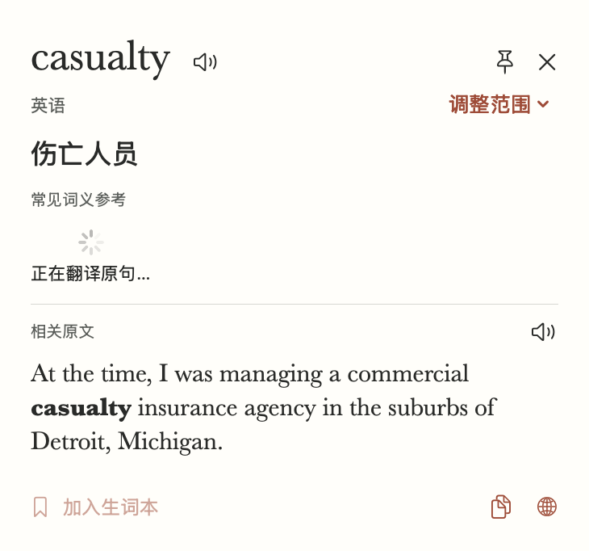
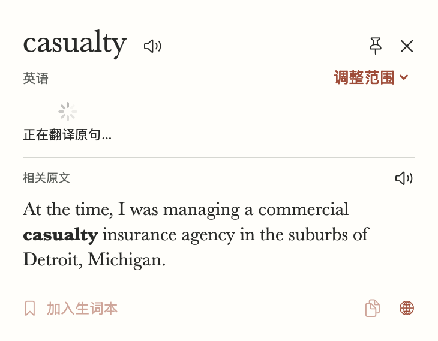
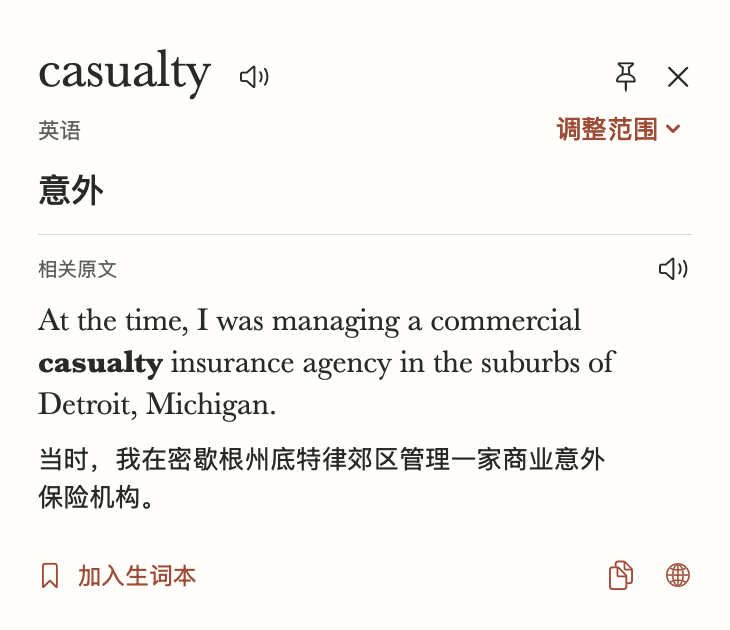

# 稳定释义延迟与质量回归（#110）

目标是取词后在 1 秒内得到当前语境的稳定释义，不把等待卡、词典首义或缓存命中冒充首次翻译完成。负责人：Codex。跟踪 [Issue #110](https://github.com/wax0629/WaxTranslate/issues/110)。

## 环境与口径

2026-11-16，本机 Intel i7-9750H、16 GiB 内存，macOS 26.6.2（25G83），Swift 6.3.3 / macOS 26.5 SDK，已安装 Apple 英语、简体中文模型。基线为 PR #109 的 `60274b341b308b049ce9ce00de58cf1d5653204e`。用户当时安装版 UUID 对应 `8011128`；下表比较的是开发基线 #109，不把它冒称为安装版实测。

原生卡片测试把固定原文画为 Retina 像素，走正式 HoverCache、准确 Vision OCR、命中位置/断句、模型、SwiftUI 卡片、缓存/历史发布和最终布局。窗口保持隐藏，默认使用应用启动预热；每个进程查 10 类样例两遍，旧、新、新、旧、旧、新各三个新进程。第一遍没有词义缓存，第二遍单列实际缓存状态。计时期间不运行构建或其他测试。截图留证另跑，截图耗时不混入性能表。

这个口径不包含物理 Option 按下/松开和屏幕获取。屏幕获取用同机已有签名/权限的独立后台探针实测，排除所有应用窗口，不保留屏幕像素；与卡片数据分开列，不将两项相加后冒充完整入口实测。完全不做启动预热的首次查询也单列。模型下载不属于已安装模型的查询计时。

测试同时核对选中的词、完整原句、UTF-16 位置、语境释义及最终可保存状态。15 秒仍未产出完整结果记为超时，错误落点不算通过。中文期望只验证该样例的关键义项，不是通用准确率。没有人工期望的独立材料标为未评分，不计入自动质量通过率。

## 结果

代码验证点：`828034f`。最终源码增加节选位置校验后，再运行三轮新版测试，均通过。最初同机交替顺序为旧、新、新、旧、旧、新；表中的基线取这组三轮，新版取最终校验后的三轮，期间没有构建或其他测试并行。

| 验证项 | 预期 | 实际结果 | 结论 |
| --- | --- | --- | --- |
| 新版未命中结果缓存，30 次 | 正确且 ≤1000 ms | p50 627.0；p95 924.0；最大 936.0 ms；30/30 义项、原句、落点通过 | 本组通过 |
| 新版结果缓存命中，30 次 | 同一原句同一位置，独立计时 | p50 378.7；p95 597.1；最大 618.8 ms；30/30 通过 | 本组通过 |
| 基线，60 次 | 失败也计入分母 | 54/60 正确；长句 bank 6 次选中 old，15 秒无有效结果；17 次超 1 秒 | 基线失败，不能把超时当正常响应 |
| 无启动预热，10 次 | 首次也 ≤1000 ms | 10/10 义项及落点通过；首次 casualty 1449 ms，其余 9 次低于 1 秒 | **首次未达 1 秒** |
| 真实屏幕获取组件 | 分离枚举和截图 | 首次 183→104 ms；新版后续四次约 66 ms | 已实测组件，不能代替整链路 |
| 真实屏幕/物理热键到稳定卡片 | 完整入口 ≤1 秒 | 后台窗口截图尝试受系统/桌面条件限制，未完成；未操作受保护的系统提示 | **未验收** |
| 独立材料 | 检查新增退化 | 41 条回归 + 38 条新材料；79/79 整句译文相同，74/79 词义与来源相同；全部模型查询低于 1 秒 | 详见逐项比较，不能算 79/79 中文准确 |
| 现有自动回归 | 断句、落点、取消/换词、词本等保持正确 | 160 共享断句、22 Vision 边界、16 实际长句加无属性接口、取消和替换发布守卫均通过 | 本机通过 |
| 原生界面与构建 | 真实卡片及 Release 可用 | 8 项查词、12 类布局、Release 构建通过 | 本机通过 |

**1 秒完整目标仍未全部验收。** 常规合成像素→原生卡片的 60 次严格门禁通过；冷启动严格门禁返回失败，真实桌面完整入口没有冒称达标。调优阶段还记录过一次 1143 ms 词组查询和一次 1004 ms 长句查询，保留在 [早期波动记录](earlier-outliers.jsonl)，有限样本无法保证任意负载都低于 1 秒。

| 样例 | 基线首遍中位数 ms | 新版首遍中位数 / 最大值 ms | 新版结果 |
| --- | ---: | ---: | --- |
| casualty-insurance | 1558 | 852 / 860 | 意外 |
| casualty-accident | 606 | 509 / 544 | 人伤亡 |
| river-bank | 691 | 569 / 615 | 岸边 |
| money-bank | 570 | 545 / 550 | 银行 |
| rule-out | 508 | 498 / 498 | 排除 |
| ops-team | 1087 | 910 / 924 | 行动小组 |
| mailing-list | 1021 | 774 / 809 | 邮件列表 |
| battery-housing | 699 | 650 / 655 | 电池外壳 |
| long-river | 落点错误，15 秒截止 | 912 / 936 | 河岸 |
| model-study | 559 | 532 / 639 | 消融实验，移除或替换模型中的某一部分，比较结果如何变化。 |

未命中/命中按实际结果缓存统计；基线失败查询的第二遍仍未命中，所以基线两组数量是 33/27，新版为 30/30。每轮查询不同画面，因此“结果缓存命中”仍可能需要 OCR，不代表画面缓存命中。

[汇总 JSON](summary.json) · [基线逐次记录](baseline.jsonl) · [新版逐次记录](current.jsonl) · [每阶段 CSV](current-stages.csv) · [样例 CSV](cases.csv) · [独立材料比较](holdout-comparison.csv) · [屏幕组件](capture.json) · [冷启动](cold.jsonl)。这些文件仅含固定测试样文。

| 旧版错误首义 | 新版等待语境证据 | 新版稳定结果 |
| --- | --- | --- |
|  |  |  |


## 改动及证据

- 自动语境查询不提前发布词典第一义项。用户的 `casualty` 原句在旧卡片先显示「伤亡人员」，新版等待语境证据后显示「意外」，复制和收藏随后可用。
- 已安装模型在卡片布局时从后台开始工作，正常对齐不等待词典，也不重复查询语言包状态和准备会话。缺包仍走已有下载界面；取消会关闭对应工作，旧请求不能写入新卡片、缓存或词本。
- 初始截取宽度从 900 到 1200 点，保持原像素和准确 OCR，减少宽行补采。精确落点优先于其他行扩展的行间距，修复点到下行 `bank` 却选中上行 `old`。
- 长句保留完整原文，以独立属性标出词、相邻名词组合和展示节选；有效时一次翻译返回三者。属性丢失时保留原回退，并复用已经得到的完整译文。数量结构的量词只在数字前缀、连续复合名词标记和名词词性同时成立时排除。
- 回退仍要求两种标记在原句同一位置相互印证，合批提交不会减少证据。冲突、丢标记、错位、取消和失败均有回归。
- macOS 26 使用静态截图接口，维持原窗口排除、坐标、Retina 像素及隐藏光标；旧系统保留原接口。

## 分段数据

`LookupTrace` 默认关闭，仅在 `--trace-lookup` 输出阶段和时间，不记录用户原文。基准通过内存事件导出固定测试样文的 JSONL。

| 阶段 | 含义 |
| --- | --- |
| capture.enumerate / capture.image | 真实屏幕枚举、图像获取；独立探针记录 |
| capture.fingerprint / capture.ocr / capture.ocr_reused | 像素校验、准确识字或确认画面未变后复用 |
| capture.expand / lookup.context | 有界补采；断句、完整性和确切落点 |
| lookup.language / lookup.dictionary | 语种判定；实际需要时查询词典 |
| translation.session / availability / prepare | 会话创建；旧流程的状态查询和准备 |
| model.marked / plain / batch | 每次真实模型请求，不把多次调用合成一个黑箱 |
| translation.linked_context / full_context / context_word_recovery | 长句对齐、完整译文及双证据恢复 |
| lookup.first_reference / first_phrase_context / excerpt_meaning | 发布参考、句译或已确认节选的时点；不等于稳定完成 |
| lookup.ready / lookup.complete / cache_hit | 后台完成、主界面发布、命中同原句同位置结果 |

`durationMs` 是该阶段持续时间，`elapsedMs` 是相对本次查询起点。父阶段包含子阶段，后台任务与布局重叠，不能直接将全部 duration 相加。基线原有 `capture.ocr` 包含指纹耗时，新版已拆开。

## 独立材料

使用 [UD English GUM 固定版本](https://github.com/UniversalDependencies/UD_English-GUM/tree/34d01cb603867d0c085896e8286a0fe01229fa37) 的测试集，语料 SHA-256 为 `99deb5746618d8ab83e5cafc2d07851e76389b2c8babf5ad9e5ef176a4619114`。依据相邻 NOUN compound 标注、词头唯一出现筛选，再按文体及样本 ID 的 SHA-256 固定排序。第二组取每类第 4–6 项，共 41 条；因其中一条用于改进量词对齐，这组按回归材料报告。实现冻结后，第三组取第 7–9 项，共 38 条，作为新材料对照。均只查原来的词头，不偷偷扩大用户选区。

五处变化分别为：室内乐作品→室内乐、过程→进程、品种→变体、盒→玉米片盒，以及法律语境 mitigator 的缓解剂→缓解者。前四处与语境相容；最后一处两版均不正确，不能作为质量通过。未增加测试例专用词表，也未更换或降级模型。

分享的比较表保留样本 ID、词义、来源、时间和整句是否相同；完整语料及本机模型输出留在 `dist`，可按下面命令重建。语料来自 GUM / Georgetown University，贡献者及 CC BY-NC-SA 4.0 许可见[官方说明](https://universaldependencies.org/treebanks/en_gum/index.html)，不打包进产品词表。

## 复现

```sh
mkdir -p dist/stable-translation
WAX_BENCH_COMPILE_ONLY=1 WAX_BENCH_BUNDLE=dist/stable-translation/Baseline.app ./scripts/benchmark-stable-translation.sh 60274b341b308b049ce9ce00de58cf1d5653204e
WAX_BENCH_COMPILE_ONLY=1 WAX_BENCH_BUNDLE=dist/stable-translation/Current.app ./scripts/benchmark-stable-translation.sh
# 两个 bundle 保留各自词表；基线源码临时目录清理后也可重复运行。
WAX_BENCH_MODE=cards WAX_BENCH_REPEATS=2 dist/stable-translation/Current.app/Contents/MacOS/waxtranlate Tests/Fixtures/stable-translation.json > dist/stable-translation/current.jsonl
python3 scripts/summarize-lookup-benchmark.py dist/stable-translation/current.jsonl --csv dist/stable-translation/stages.csv --require-target
# 严格门禁：任一错义、未评分或超过 1000 ms 都返回非零。不得删除慢样本。
WAX_BENCH_MODE=cards WAX_BENCH_COLD=1 dist/stable-translation/Current.app/Contents/MacOS/waxtranlate Tests/Fixtures/stable-translation.json > dist/stable-translation/cold.jsonl
WAX_BENCH_MODE=cards WAX_BENCH_IMAGES=dist/stable-translation/images dist/stable-translation/Current.app/Contents/MacOS/waxtranlate Tests/Fixtures/stable-translation.json > dist/stable-translation/images-only.jsonl

curl -fsSL https://raw.githubusercontent.com/UniversalDependencies/UD_English-GUM/34d01cb603867d0c085896e8286a0fe01229fa37/en_gum-ud-test.conllu -o dist/stable-translation/gum.conllu
python3 scripts/phrase-corpus-check.py dist/stable-translation/gum.conllu dist/stable-translation/fresh.json --round 3 --head-only
dist/stable-translation/Baseline.app/Contents/MacOS/waxtranlate dist/stable-translation/fresh.json > dist/stable-translation/fresh-before.jsonl
dist/stable-translation/Current.app/Contents/MacOS/waxtranlate dist/stable-translation/fresh.json > dist/stable-translation/fresh-after.jsonl

./scripts/check.sh
./scripts/check-hover-feedback.sh
./scripts/check-card-layouts.sh dist/stable-translation/layouts
swift build -c release -j 2
```

屏幕阶段探针只在具有现成录屏授权的本机签名测试 bundle 中运行 `WAX_BENCH_MODE=capture`。它不弹出权限申请，不改系统授权，不安装全局按键监听。缺少模型、权限或工具链应报告未执行，不能当作通过。Windows 对应流程没有提前发布普通词典首义，本轮未修改其代码；本机 Windows 和跨应用物理手势验收单列。
